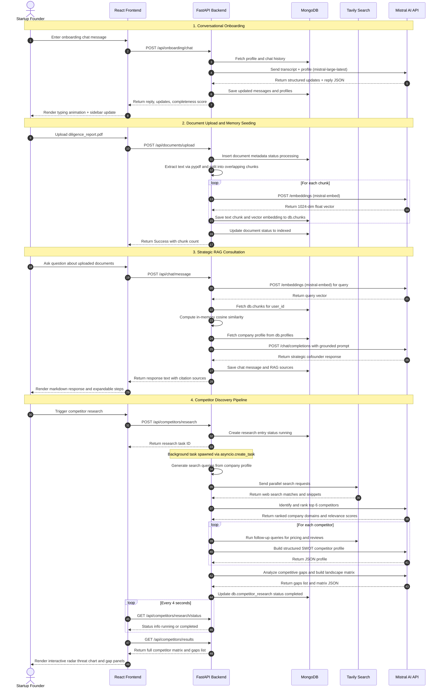

# Cofoundr OS: Developer Documentation & System Architecture

Welcome to the **Cofoundr OS** developer documentation. This document is a technical reference guide for future developers onboarding to this codebase. It documents the **actual implementation** currently present in the project.

Cofoundr OS is a multi-agent decision engine with persistent company memory designed for early-stage founders. It operates as a hybrid React + TanStack Start frontend and a Python FastAPI backend, backed by MongoDB.

---

## Table of Contents
1. [System Overview & Architecture](#1-system-overview--architecture)
   - [Frontend Architecture](#frontend-architecture)
   - [Backend Architecture](#backend-architecture)
   - [Database Architecture](#database-architecture)
   - [Authentication & Sessions](#authentication--sessions)
   - [AI & LLM Integration Strategy](#aillm-integration-strategy)
   - [Shared Profile Context & Data Flow](#shared-profile-context--data-flow)
2. [End-to-End System Flow Diagram](#2-end-to-end-system-flow-diagram)
3. [Feature Deep-Dives](#3-feature-deep-dives)
   - [Feature 1: Conversational Startup Onboarding](#feature-1-conversational-startup-onboarding)
   - [Feature 2: Persistent Company Memory (RAG)](#feature-2-persistent-company-memory-rag)
   - [Feature 3: AI Co-Founder Chatbot](#feature-3-ai-co-founder-chatbot)
   - [Feature 4: Startup Health Dashboard V1](#feature-4-startup-health-dashboard-v1)
   - [Feature 5: Competitor Research V1](#feature-5-competitor-research-v1)
   - [Feature 6: Opportunities & Decision Intelligence Engine (See OPPORTUNITY_FEATURE_DOCUMENTATION.md)](./OPPORTUNITY_FEATURE_DOCUMENTATION.md)
4. [Database Schema Specs](#4-database-schema-specs)
5. [Developer Setup & Configuration](#5-developer-setup--configuration)
6. [Extension Guide & Implementation Decisions](#6-extension-guide--implementation-decisions)

---

## 1. System Overview & Architecture

Cofoundr OS uses a split, modular architecture:

```
┌────────────────────────────────────────────────────────┐
│               React Frontend Client                    │
│           (TanStack Start Dev Server)                  │
└───────────────────────────┬────────────────────────────┘
                            │ (Vite Proxy: /api/*)
                            ▼
┌────────────────────────────────────────────────────────┐
│                Python FastAPI Server                   │
│                    (Port 8000)                         │
└───────────────┬─────────────────────────┬──────────────┘
                │                         │
                ▼                         ▼
┌────────────────────────┐      ┌────────────────────────┐
│      MongoDB Database  │      │    External APIs       │
│      (Local or Atlas)  │      │   (Mistral & Tavily)   │
└────────────────────────┘      └────────────────────────┘
```

### Frontend Architecture
- **Framework**: React 19, TypeScript, Vite, Tailwind CSS v4.
- **Routing**: [TanStack Router](https://tanstack.com/router) with strict type safety.
- **Data Fetching**: [TanStack Query](https://tanstack.com/query) (`@tanstack/react-query`) for API resource caching.
- **Global State**: Managed via `src/lib/os-store.tsx`. It uses a custom React Context provider (`OsProvider`) and hooks (`useOs`) to synchronize profile data, health reports, task logs, and simulated activity ticks. It also uses `localStorage` to cache local session profiles.
- **Authentication Wrapper**: `src/lib/auth-context.tsx` which exposes session credentials and JWT token persistence.

### Backend Architecture
- **Primary API Server**: Python FastAPI (running on port 8000). The routing tree is mounted under `/api` and is structured into:
  - Auth routes: `backend/routers/auth.py`
  - Onboarding chat and updates: `backend/routers/onboarding.py`
  - Memory RAG documents library: `backend/routers/documents.py`
  - Grounded Chat: `backend/routers/chat.py`
  - Health checks: `backend/routers/health.py`
  - Competitor Discovery Pipeline: `backend/routers/competitors.py`
- **Secondary Server Functions**: TanStack Start supports server-side Nitro endpoints. In `src/api/onboarding.ts` and `src/api/chat.ts`, there are legacy/parallel TS server functions that query MongoDB directly using `src/lib/db.ts` and run completions via `src/lib/mistral.ts`. The frontend calls `completeOnboarding` from these TS server functions, but routes other interactions to FastAPI.

### Database Architecture
- **Engine**: MongoDB (Local instance or MongoDB Atlas Cloud).
- **Driver**: `motor` (AsyncIOMotorClient) in Python; `mongodb` (MongoClient) in TypeScript.
- **Vector Search Strategy**: Dual retrieval capability:
  1. **Atlas Vector Search**: Tries to run a native `$vectorSearch` pipeline on the `chunks` collection.
  2. **In-Memory Cosine Fallback**: If Atlas indexes are unavailable, it pulls all chunks for the active user/company and computes cosine similarity in memory.

### Authentication & Sessions
- **Python Backend**: Standard JWT tokens utilizing `HS256` symmetric signing.
- **Optional/Guest User Access**: To ensure a friction-free trial, `backend/auth.py` implements `get_optional_current_user`. If a valid JWT Bearer header is missing or parsing fails, it falls back to a mock user:
  ```python
  {
      "id": "guest_session_user",
      "email": "guest@cofoundr.os",
      "username": "guest_founder",
      "created_at": datetime.utcnow()
  }
  ```
  Consequently, all startup data created in guest mode is saved under `user_id = "guest_session_user"` in MongoDB.

### AI & LLM Integration Strategy
All AI workflows route to **Mistral AI Developer API** (historically mapped or named under Gemini/Mistral configurations).

| Use Case | Model | Dimensions |
|---|---|---|
| Conversational Onboarding / Structuring | `mistral-large-latest` | — |
| RAG Chat Agent (Python) | `mistral-small-2503` | — |
| RAG Chat Agent (TypeScript fallback) | `mistral-large-latest` | — |
| Text Embeddings | `mistral-embed` | 1024 |
| Multimodal Visual Extraction | `pixtral-12b-latest` | — |

### Shared Profile Context & Data Flow
The 25-field **Company Profile** (defined in `backend/models.py`) is the central context of the application. It resides in MongoDB `profiles` (and `companies` in TS).
Updating this profile triggers downstream calculations:
1. **Conversational Onboarding** writes updates extracted from chat.
2. **Document Processing** parses text files, sending contents to the LLM to extract profile details.
3. **Health Dashboard** runs checks directly against the updated fields.
4. **Competitor Discovery** reads the industry, problem, and target customer to generate search queries.

---

## 2. End-to-End System Flow Diagram

The diagram below details the end-to-end data lifecycle across the UI, API Gateway, Vector Database, Search engine, and LLM:



---

## 3. Feature Deep-Dives

### Feature 1: Conversational Startup Onboarding

#### Purpose
Low-friction startup profiling. Collects, refines, and formats 25 parameters describing the startup without form questionnaires. An AI partner interviews the founder conversationally and extracts structured data from their responses.

#### User Flow
1. Founder enters chat messages in the onboarding panel.
2. The AI co-founder responds conversationally, simultaneously identifying profile attributes in the user's message (e.g. name, validation, traction).
3. The profile panel on the right updates in real-time as attributes are extracted.
4. Once satisfied, the founder clicks **Complete Onboarding & Build Workspace**, saving the final company profile.

#### Frontend Components
| File | Role |
|---|---|
| `src/routes/onboarding.tsx` | Full onboarding page: chat logs, suggested replies, inline value edits, progress layout, and completion trigger |

#### Backend API Endpoints
| Method | Endpoint | Description |
|---|---|---|
| `POST` | `/api/onboarding/chat` | Processes incoming message, merges past history, extracts fields, saves updates, responds |
| `GET` | `/api/onboarding/profile` | Retrieves current profile, calculates completeness score |
| `PUT` | `/api/onboarding/profile` | Manually updates profile values |
| `POST` | `/api/onboarding/reset` | Clears active profile and conversation |

#### Important Backend Files
| File | Role |
|---|---|
| `backend/routers/onboarding.py` | API router handling request/response lifecycle |
| `backend/services/gemini_service.py` | Core business logic implementing `process_conversational_turn` |

#### AI Model & Prompts
- **Model**: `mistral-large-latest` (using JSON response format: `{"type": "json_object"}`).
- **System Prompt**: Located in `YC_PARTNER_SYSTEM_PROMPT` inside `gemini_service.py`. It details a level-based priority hierarchy to dictate conversational flow:
  - **Level 1** (Critical): Company name, one-line pitch, industry, problem, solution
  - **Level 2** (Important): Product details, target customer, business model
  - **Level 3** (Strategic): Revenue model, traction, funding stage, team size
  - **Level 4** (Advanced): Challenges, competitive landscape, long-term vision

#### Data Flow / Processing Pipeline
```
User Message
  → Router receives ChatRequest
  → DB Fetch: profile + conversation history (user_id)
  → Build prompt: YC_PARTNER_SYSTEM_PROMPT + history + user message
  → LLM Call: mistral-large-latest (JSON mode)
  → Parse JSON response: {reply, profile_updates}
  → Merge extracted updates into existing profile
  → Recalculate completeness score
  → DB Write: updated profile + appended conversation
  → Return ChatResponse to frontend
```

#### Inputs & Outputs
- **Input**: User message string (via `ChatRequest` model).
- **Output**: `ChatResponse` containing `assistant_reply`, `profile_updates` dictionary, full `profile` model, and `completeness_score`.

#### Connections to Other Features
- Seeding the company profile creates the baseline context for RAG Chat queries, Startup Health Dashboard checks, and Competitor Search queries.
- Profile updates from onboarding automatically trigger health score recalculation.

#### Error Handling & Fallbacks
- **Smart Fallback Engine**: If the Mistral API fails or `MISTRAL_API_KEY` is missing, `process_conversational_turn` catches the exception and executes `_smart_fallback_engine`. This fallback uses regex/substring matching on user inputs (e.g. searching for "MVP", "surveyed", or "travel planner") and issues priority-based replies with mock extracted profile fields.

#### Durable Double-Write on Completion
On onboarding completion, the frontend makes two separate writes to ensure database consistency across environments:
1. Triggers the FastAPI profile route to update MongoDB `profiles` collection (linked to `user_id`).
2. Runs the TanStack Start Server Function `completeOnboarding` (`src/api/onboarding.ts`) to insert the profile into the `companies` collection.

---

### Feature 2: Persistent Company Memory (RAG)

#### Purpose
Creates a queryable corporate memory layer. Founders upload business plans, pitch decks, market research, or spreadsheets, which are parsed, chunked, embedded, and indexed for semantic retrieval.

#### User Flow
1. Founder visits the **Knowledge Base** (`/app/knowledge`).
2. Drag-and-drops supported files (PDF, DOCX, PPTX, TXT, MD, PNG, JPG).
3. The system processes the document (splitting, embedding, indexing).
4. The file appears in the list showing status, category, size, and generated chunk counts.
5. The founder can reclassify categories, rename files, replace files, or delete documents.

#### Frontend Components
| File | Role |
|---|---|
| `src/routes/app.knowledge.tsx` | Manages drag-and-drop file states, search filters, rename modal, and category dropdowns |

#### Backend API Endpoints
| Method | Endpoint | Description |
|---|---|---|
| `POST` | `/api/documents/upload` | Handles multi-part file bytes, calls `process_and_index_document` |
| `GET` | `/api/documents` | Lists documents (with regex name search and category filters) |
| `PUT` | `/api/documents/{doc_id}/rename` | Updates filename in both `documents` and `chunks` metadata |
| `PUT` | `/api/documents/{doc_id}/reclassify` | Updates category classification for a document and its chunks |
| `POST` | `/api/documents/{doc_id}/replace` | Deletes old chunks, resets metadata, splits and embeds new file |
| `DELETE` | `/api/documents/{doc_id}` | Removes document entry, all its chunks, and clears the reference in the profile |

#### Important Backend Files
| File | Role |
|---|---|
| `backend/routers/documents.py` | API router for document library CRUD operations |
| `backend/services/document_processor.py` | Text extraction, classification, chunking, and embedding pipeline |
| `backend/services/rag_service.py` | Context retrieval via vector search or cosine fallback |
| `backend/services/doc_service.py` | LLM-based profile field extraction from document text |

#### Data Flow / Processing Pipeline
```
File Bytes & Name
  → extract_text_from_bytes (format-specific parser)
  → classify_document (categorize by content type)
  → chunk_text (size=1000 chars, overlap=200 chars)
  → For each chunk:
      → generate_embedding (mistral-embed → 1024-dim vector)
      → Write to db.chunks
  → Update db.documents: status = "indexed", chunkCount = N
  → Optionally: extract_profile_from_document → merge into db.profiles
```

#### Text Extraction Support
| Format | Extraction Method |
|---|---|
| `.pdf` | `pypdf.PdfReader` text extraction |
| `.docx` / `.doc` | `docx.Document` paragraph extraction |
| `.pptx` / `.ppt` | `pptx.Presentation` slide shape text matching |
| `.txt` / `.md` / `.csv` / `.json` | UTF-8 decoding with fallback encoding options |
| `.png` / `.jpeg` / `.webp` (images) | Multimodal visual analysis using `pixtral-12b-latest` |

For image files, the prompt instructs the model to describe charts, labels, text relationships, and numeric tables in detail to build rich text context for search embeddings.

#### Chunking Strategy
- **Chunk size**: 1000 characters
- **Overlap**: 200 characters (ensures context continuity across chunk boundaries)
- **Metadata per chunk**: `filename`, `category`, `chunkIndex`, `document_id`, `user_id`

#### Similarity Search Mechanism
When query matches are retrieved (`retrieve_context_chunks`), the engine tries Atlas Vector Search first. If not configured, it runs cosine similarity in-memory:

```
cosine_similarity(A, B) = (A · B) / (||A|| × ||B||)
```

The top-K most similar chunks (default K=5) are returned as grounding context.

#### Error Handling & Fallbacks
- If document parsing throws an exception, the pipeline catches it, writes the stack trace/error detail directly to the document's `error` field in MongoDB, and sets the document status to `"failed"`.
- If `MISTRAL_API_KEY` is missing, `generate_embedding` falls back to returning a 1024-dimensional zero vector, allowing the platform to run without crashing.

---

### Feature 3: AI Co-Founder Chatbot

#### Purpose
A grounded chatbot allowing founders to consult their startup context. It pulls chunks from the Persistent Company Memory (RAG) and references company profiles to construct informed, strategic answers.

#### User Flow
1. Founder enters the **Co-Founder Chat** (`/app/chat`).
2. Selects an existing conversation or starts a new one.
3. Enters a query (e.g. "What are our strategic challenges?") or attaches a temporary document.
4. The AI cofounder responds with a grounded text reply, showing research steps and sources.
5. The founder can permanently save chat attachments to the Knowledge Base.

#### Frontend Components
| File | Role |
|---|---|
| `src/routes/app.chat.tsx` | Messaging layouts, attachment uploads, saving triggers, and research step expanders |

#### Backend API Endpoints
| Method | Endpoint | Description |
|---|---|---|
| `POST` | `/api/chat/message` | Extracts user query, builds RAG context, runs LLM generation, saves history |
| `GET` | `/api/chat/conversations` | Lists all conversations for a user |
| `GET` | `/api/chat/conversations/{conv_id}` | Gets a specific conversation with full message history |
| `POST` | `/api/chat/upload-attachment` | Writes temp file to `uploads/chat_attachments/` with UUID, extracts text, returns `ChatAttachment` |
| `POST` | `/api/chat/conversations/{conv_id}/messages/{msg_index}/save-attachment` | Reads temp file, indexes it to workspace via `process_and_index_document`, marks as saved |

#### Important Backend Files
| File | Role |
|---|---|
| `backend/routers/chat.py` | API router: message handling, attachment upload, conversation management |
| `backend/services/rag_service.py` | `build_rag_context`: assembles profile summary, document index, and matched vector chunks |

#### AI Model & Prompts
- **Model**: `mistral-small-2503`
- **System Prompt**: Located in `RAG_SYSTEM_PROMPT` inside `chat.py`. It injects:
  - Company profile summary (name, pitch, industry, stage, etc.)
  - Document index listing (filenames, categories, chunk counts)
  - Top-K matched RAG vector chunks (grounding context)
  - Conversation history (last 8 messages)

#### Data Flow / Processing Pipeline
```
User Query
  → build_rag_context:
      → Fetch Profile from db.profiles
      → Fetch Document inventory from db.documents
      → generate_embedding(query) → query vector
      → retrieve_context_chunks(query vector, user_id)
          → Atlas $vectorSearch OR in-memory cosine fallback
          → Return top-K chunks with text + metadata
  → Construct grounded prompt:
      → RAG_SYSTEM_PROMPT + profile summary + document index + chunks + conversation history
  → LLM Call: mistral-small-2503
  → Parse response, extract research steps and source citations
  → Save to db.chat_conversations (append message with steps/sources)
  → Return ChatResponse to frontend
```

#### Poison Phrase Mitigation
During RAG chat generation, older LLM calls might have generated errors or claimed document indexing issues. To avoid propagating historical errors through chat memory, `chat.py` loops through the last 8 messages and replaces any assistant reply containing poison phrases (e.g. "configuration issue", "unable to access", "can't access your") with:
```
"I have access to your documents. Let me analyze them for you."
```

#### Error Handling
- If the RAG retrieval fails, the chat router falls back to generating replies grounded solely in the Company Profile details.
- If the API key is missing, it returns a mock reply explaining that it is running in demo mode.

---

### Feature 4: Startup Health Dashboard V1

#### Purpose
Transparent, rule-based audit scoring tool that evaluates the startup across 5 health dimensions. No AI/LLM is used for scoring — it is purely deterministic and based on profile field presence and document indexing status.

#### User Flow
1. Founder views **Startup Health** (`/app/health`).
2. The page renders a composite gauge ring (Overall Score) and a radar chart displaying dimension scores.
3. Displays card panels for each dimension: Business, Product, Customer, Market, and Competition.
4. Each card shows the dimension score, satisfied checks, missing areas, and specific recommendations.
5. The founder can click **Recalculate Health** to force a live recalculation.

#### Frontend Components
| File | Role |
|---|---|
| `src/routes/app.health.tsx` | Renders radar charts, gauge rings, and dimension progress panels |

#### Backend API Endpoints
| Method | Endpoint | Description |
|---|---|---|
| `GET` | `/api/health/report` | Fetches saved report from database (or recalculates if not present) |
| `POST` | `/api/health/recalculate` | Runs `calculate_health` live against current profile and returns report |

#### Important Backend Files
| File | Role |
|---|---|
| `backend/routers/health.py` | API router: report retrieval and recalculation triggers |
| `backend/services/health_engine.py` | Rules-based scoring engine, driver mapping, and recommendation compiler |

#### Scoring Rules & Formula

Each dimension has a maximum score of 100 points:

**Business Health (Weight: 100)**
| Check | Points | Condition |
|---|---|---|
| Company name present | +10 | `company_name` is non-empty |
| One-line pitch present | +10 | `one_line_pitch` is non-empty |
| Business model defined | +15 | `business_model` is non-empty |
| Revenue model defined | +15 | `revenue_model` is non-empty |
| Active revenue traction | +15 | `traction` contains revenue-related content |
| Funding stage identified | +15 | `funding_stage` is non-empty |
| Business plan/financial docs indexed | +20 | Documents with category `business_plan` or `financial_report` exist and are `indexed` |

**Product Health (Weight: 100)**
| Check | Points | Condition |
|---|---|---|
| Product defined | +20 | `product` is non-empty |
| Description present | +15 | `description` is non-empty |
| Current stage identified | +15 | `current_stage` is non-empty |
| Progress indicators | +15 | `traction` contains product progress |
| Validation details | +15 | Evidence of user testing or validation |
| Specs/roadmap docs indexed | +20 | Documents with category `blueprint` exist and are `indexed` |

**Customer Health (Weight: 100)**
| Check | Points | Condition |
|---|---|---|
| ICP defined | +25 | `target_customer` is non-empty |
| Survey/interview text | +25 | Evidence of customer research in profile |
| User/customer counts | +25 | `total_users` > 0 |
| Customer research docs indexed | +25 | Documents with category `research` exist and are `indexed` |

**Market Health (Weight: 100)**
| Check | Points | Condition |
|---|---|---|
| Industry defined | +25 | `industry` is non-empty |
| URL/HQ location present | +25 | `website` or `location` is non-empty |
| Pitch deck/research docs indexed | +25 | Documents with category `pitch_deck` or `research` exist |
| Long-term vision defined | +25 | Vision-related profile content exists |

**Competition Health (Weight: 100)**
| Check | Points | Condition |
|---|---|---|
| Competitors listed | +40 | Competitor data available in profile |
| Pitch deck/research docs indexed | +30 | Relevant documents exist |
| Bottlenecks/challenges identified | +30 | `problem_statement` or challenges content exists |

#### Insufficient Data Rule
If a dimension has fewer than **2 parameters** satisfied (or fewer than **1** for Competition Health), its score is set to **-1** ("Insufficient data"). This prevents misleadingly low scores when a dimension simply hasn't been addressed yet.

#### Overall Score Calculation
```
Overall Score = Average of all dimension scores that are >= 0
```
Dimensions with -1 (insufficient data) are excluded from the average.

#### State Synchronization
Any successful update to the company profile (manual edit, onboarding chat, document processing extraction) automatically invokes `calculate_health` in the backend, ensuring health scores remain synchronized with the profile state.

---

### Feature 5: Competitor Research V1

#### Purpose
Autonomous competitor discovery agent. Scours the web, extracts target competitor characteristics, compiles SWOT matrices, and surfaces competitive gaps — all without manual research from the founder.

#### User Flow
1. Founder views **Competitor Intel** (`/app/competitors`).
2. If no research is found, a research job is automatically triggered.
3. Renders a loading panel showing pipeline status ("Tavily Search", "Deduplication", etc.).
4. Once completed (polled every 4s), displays stats (threats discovered, sources tracked) and ranked competitor cards.
5. Founder can click a card to view a detail page (`/app/competitors/$id`) containing HQ, funding, SWOT analysis, value proposition, and side-by-side comparison matrices.

#### Frontend Components
| File | Role |
|---|---|
| `src/routes/app.competitors.tsx` | Manages polling lifecycle, renders stats and competitor list cards |
| `src/routes/app.competitors.$id.tsx` | Individual competitor detail: SWOT displays, comparison table, and backlinks |

#### Backend API Endpoints
| Method | Endpoint | Description |
|---|---|---|
| `POST` | `/api/competitors/research` | Checks if already running, triggers background pipeline |
| `GET` | `/api/competitors/research/status` | Returns job state (`running`, `completed`, `failed`) |
| `GET` | `/api/competitors/results` | Returns latest compiled competitor research result |
| `GET` | `/api/competitors/{competitor_id}` | Returns specific competitor details from results |

#### Important Backend Files
| File | Role |
|---|---|
| `backend/routers/competitors.py` | API router: trigger, status polling, and results retrieval |
| `backend/services/competitor_research_service.py` | Background task orchestrator: query generation, search dispatch, profiling loop |
| `backend/services/web_search_service.py` | Tavily search wrapper: query formulation, domain deduplication, AI ranking |
| `backend/services/competitor_enrichment_service.py` | Follow-up enrichment queries, SWOT analysis, and cross-comparison builder |

#### Data Flow / Processing Pipeline
```
Trigger Research
  → generate_search_queries(profile):
      → Build queries from: industry, business_model, target_customer, problem_statement
      → Queries like: "{industry} competitors startups", "alternatives to {product}",
        "companies solving {problem}"
  → parallel search_tavily(queries):
      → POST to Tavily API with each query
      → Collect URLs, titles, snippets
  → merge_and_deduplicate:
      → Deduplicate by domain
      → Filter out media sites, review aggregators, social media
  → identify_and_rank_companies (mistral-large-latest):
      → LLM ranks candidate domains by relevance score (0-100)
      → Select top 6 competitors
  → For each competitor:
      → enrich_competitor_with_searches:
          → Follow-up Tavily queries: "{company} pricing", "{company} reviews",
            "{company} funding investors"
      → build_competitor_profile (mistral-large-latest):
          → Structure: name, HQ, founded year, funding, value proposition,
            strengths, weaknesses, key features
  → generate_comparison_and_gaps (mistral-large-latest):
      → Build strategic dimension comparison matrix
      → Identify market gaps and opportunities
  → Save to db.competitor_research:
      → status = "completed"
      → Store competitors array, comparison object, gaps array
```

#### Asynchronous Execution Model
Triggering research runs the pipeline in a background thread using Python's `asyncio.create_task(run_research_pipeline(...))`, allowing the API to respond immediately with a success acknowledgment while the agent executes. The frontend polls every 4 seconds to check status.

#### AI Models & Search Configuration
- **Search Engine**: Tavily API exclusively (DuckDuckGo search is disabled in `web_search_service.py` to prevent scraping blocks, returning `[]`).
- **LLM**: `mistral-large-latest` is used for:
  - Ranking competitor domains by relevance
  - Structuring individual competitor profiles (founded year, SWOT, value proposition)
  - Performing strategic cross-competitor gaps analysis

#### Domain Filtering
The search deduplication pipeline filters out domains from these categories:
- Social media (twitter.com, linkedin.com, facebook.com)
- Review/aggregator sites (g2.com, capterra.com, trustradius.com)
- News/media (techcrunch.com, forbes.com, bloomberg.com)
- General reference (wikipedia.org, crunchbase.com)

---

## 4. Database Schema Specs

Database name: `cofoundr_os` (configurable via `MONGODB_DB_NAME` env var).

### Collection: `users`
Registered platform users.

| Field | Type | Description |
|---|---|---|
| `_id` | `ObjectId` | Primary key |
| `email` | `string` | Unique index |
| `username` | `string` | Unique index |
| `password_hash` | `string` | SHA-256 hashed with salt (`cofoundr_salt_2026`) |
| `created_at` | `Date` | Registration timestamp |

### Collection: `profiles`
Primary company profile document. Kept in sync with onboarding, document processing, and health.

| Field | Type | Description |
|---|---|---|
| `_id` | `ObjectId` | Primary key |
| `user_id` | `string` | Unique index lookup |
| `company_name` | `string` | Startup name |
| `one_line_pitch` | `string` | Elevator pitch |
| `description` | `string` | Extended company description |
| `industry` | `string` | Industry vertical |
| `problem_statement` | `string` | Problem being solved |
| `solution` | `string` | Solution approach |
| `product` | `string` | Product name/description |
| `target_customer` | `string` | ICP description |
| `business_model` | `string` | Business model type |
| `revenue_model` | `string` | Revenue generation approach |
| `current_stage` | `string` | Startup lifecycle stage |
| `location` | `string` | HQ location |
| `website` | `string` | Company URL |
| `traction` | `string` | Traction and metrics summary |
| `profile_completeness` | `integer` | 0-100 completeness score |
| `monthly_revenue` | `float` | Monthly revenue figure |
| `total_users` | `integer` | Total user count |
| `funding_raised` | `float` | Total funding raised |
| `funding_stage` | `string` | Current funding stage |
| `runway_months` | `float` | Remaining runway in months |
| `uploaded_documents` | `Array<string>` | List of uploaded filenames |

### Collection: `documents`
File metadata for persistent memory documents.

| Field | Type | Description |
|---|---|---|
| `_id` | `ObjectId` | Primary key |
| `user_id` | `string` | Owner user (indexed with `uploadedAt`) |
| `filename` | `string` | Original filename |
| `category` | `string` | One of: `business_plan`, `financial_report`, `pitch_deck`, `research`, `blueprint`, `other` |
| `mimeType` | `string` | MIME type of the uploaded file |
| `fileSizeBytes` | `integer` | File size in bytes |
| `chunkCount` | `integer` | Number of generated text chunks |
| `status` | `string` | `processing`, `indexed`, or `failed` |
| `uploadedAt` | `Date` | Upload timestamp |
| `error` | `string` | Captured exception details on failure |

### Collection: `chunks`
Raw overlapping text slices and vector embeddings for RAG retrieval.

| Field | Type | Description |
|---|---|---|
| `_id` | `ObjectId` | Primary key |
| `document_id` | `string` | Parent document reference (indexed with `user_id`) |
| `user_id` | `string` | Owner user |
| `text` | `string` | Content chunk text |
| `embedding` | `Array<float>` | 1024-dimensional float vector |
| `chunkIndex` | `integer` | Position index within the document |
| `metadata` | `object` | `{"filename": string, "category": string}` |
| `createdAt` | `Date` | Creation timestamp |

### Collection: `chat_conversations`
Conversation records for RAG chat.

| Field | Type | Description |
|---|---|---|
| `_id` | `ObjectId` | Primary key |
| `user_id` | `string` | Owner user (indexed) |
| `title` | `string` | Conversation title |
| `messages` | `Array<Message>` | Ordered message array |
| `messages[].role` | `string` | `user` or `assistant` |
| `messages[].text` | `string` | Message content |
| `messages[].steps` | `Array<string>` | Calculated research steps (assistant only) |
| `messages[].sources` | `Array<string>` | Citation file list (assistant only) |
| `messages[].attachment` | `object` | Temporary upload reference (user only) |
| `createdAt` | `Date` | Creation timestamp |
| `updatedAt` | `Date` | Last update timestamp |

### Collection: `health_reports`
Saved health scores and recommendations.

| Field | Type | Description |
|---|---|---|
| `_id` | `ObjectId` | Primary key |
| `user_id` | `string` | Owner user (indexed) |
| `overall_score` | `integer` | Composite health score |
| `status` | `string` | Report status label |
| `components` | `Array<Component>` | Per-dimension scores, satisfied checks, and recommendations |
| `missing_areas` | `Array<string>` | Profile gaps identified |
| `recommendations` | `Array<string>` | Prioritized action items |
| `calculated_at` | `Date` | Calculation timestamp |

### Collection: `competitor_research`
Compiled competitor research runs and analysis.

| Field | Type | Description |
|---|---|---|
| `_id` | `ObjectId` | Primary key |
| `user_id` | `string` | Owner user (indexed) |
| `competitors` | `Array<Competitor>` | Detailed competitor profiles (name, HQ, SWOT, features, etc.) |
| `comparison` | `object` | Strategic dimension mapping matrix |
| `gaps` | `Array<Gap>` | Market opportunities discovered |
| `research_status` | `string` | `pending`, `running`, `completed`, or `failed` |
| `started_at` | `Date` | Pipeline start timestamp |
| `completed_at` | `Date` | Pipeline completion timestamp |

---

## 5. Developer Setup & Configuration

### Environment Variables
Configure these in a `.env` file at the root of the project:

```bash
# MongoDB Connection String (Local or Atlas)
MONGODB_URI=mongodb://localhost:27017
MONGODB_DB_NAME=cofoundr_os

# LLM API Authentication
# Note: Internally mapped as MISTRAL_API_KEY in config.py
MISTRAL_API_KEY=your_mistral_api_key_here

# Web Search Discovery API (Required for Competitor Research)
TAVILY_API_KEY=your_tavily_api_key_here

# JWT Signature Secret
JWT_SECRET=cofoundr_super_secret_jwt_key_2026
```

### Installation & Run Commands

**Backend Setup** (Python 3.10+):
```bash
cd backend
python -m venv .venv
.venv\Scripts\activate       # Windows
# source .venv/bin/activate  # macOS/Linux
pip install -r requirements.txt
python main.py               # Starts FastAPI on http://localhost:8000
```

**Frontend Setup** (Node.js 18+):
```bash
npm install
npm run dev                  # Starts TanStack Start dev server on http://localhost:5173
```

The Vite dev server automatically proxies all `/api/*` requests to `http://localhost:8000` (configured in `vite.config.ts`).

### Required External Services
| Service | Purpose | Required For |
|---|---|---|
| MongoDB (local or Atlas) | Data persistence | All features |
| Mistral AI API | LLM completions and embeddings | Onboarding, RAG, Chat, Competitor Research |
| Tavily API | Web search | Competitor Research only |

---

## 6. Extension Guide & Implementation Decisions

### How to Add a New Company Profile Parameter

If you need to track a new profile field (e.g. `customer_acquisition_cost`):

1. **Pydantic Model**: Add the field to the `CompanyProfile` model inside `backend/models.py`.
2. **Onboarding Extraction Schema**:
   - Update `YC_PARTNER_SYSTEM_PROMPT` and `ONBOARDING_RESPONSE_SCHEMA` in `backend/services/gemini_service.py` to instruct Mistral to extract this parameter.
   - Update `CompanyProfileFields` and `ONBOARDING_RESPONSE_SCHEMA` in `src/api/onboarding.ts`.
3. **UI State**: Update the `ProfileState` type and rendering elements in `src/routes/onboarding.tsx` to display the parameter in the profile editor.
4. **Health Scoring** (optional): Add a scoring check in `backend/services/health_engine.py` if the field should contribute to a health dimension.

### How to Add a New Rule-Based Health Check

To add a test scoring parameter (e.g., checking if HQ is in a high-growth tech hub):

1. **Health Engine Logic**: Edit `backend/services/health_engine.py`. Add logic in `calculate_health` inside the relevant scoring block:
   ```python
   location = profile.get("location", "").lower()
   if "san francisco" in location or "bangalore" in location or "london" in location:
       mkt_score += 10
       mkt_found.append("Located in top-tier startup hub")
   ```
2. **Adjust total weight**: If adding points, adjust the maximum or renormalize scores to maintain the 0-100 scale.

### How to Add a New Document Category

1. **Backend Model**: Add the category string to the allowed values in `document_processor.py` classification logic.
2. **Health Engine**: Map the new category to the relevant health dimension in `health_engine.py`.
3. **Frontend UI**: Add the category option to the dropdown in `app.knowledge.tsx`.

### Key Implementation Decisions & Known Limitations

| Decision | Rationale |
|---|---|
| **DuckDuckGo Search Disabled** | DuckDuckGo scraping was blocked in production. All search queries fall back to Tavily API exclusively. |
| **In-Memory Cosine Similarity** | MongoDB Atlas Vector Search requires a paid M10+ cluster. The fallback computes cosine similarity in Python for development/small datasets. For >10,000 chunks, enable Atlas Vector Search indexes. |
| **SHA-256 with Hardcoded Salt** | Simplified auth for MVP. Production deployments should migrate to `bcrypt` or `argon2`. |
| **Guest User Fallback** | Enables friction-free demo usage. All guest data shares `user_id = "guest_session_user"`, so concurrent guest sessions share state. |
| **Synchronous File Extraction** | Text extraction runs in the API thread. For large PDFs or enterprise use, offload to background workers (Celery, etc.). |
| **Dual MongoDB Clients** | Python (`motor`) and TypeScript (`mongodb`) maintain separate connection pools to the same database. This is a legacy artifact of the hybrid architecture. |
| **Poison Phrase Replacement** | Prevents historical LLM errors from polluting chat context windows. A pragmatic fix for context quality. |

---

## Project File Structure Reference

```
founder-os/
├── backend/
│   ├── main.py                    # FastAPI entry point, CORS, router mounting
│   ├── config.py                  # Environment config, API keys, JWT settings
│   ├── database.py                # MongoDB connection (motor AsyncIOMotorClient)
│   ├── models.py                  # Pydantic models (CompanyProfile, HealthReport, etc.)
│   ├── auth.py                    # JWT creation, verification, guest fallback
│   ├── routers/
│   │   ├── auth.py                # /api/auth/* endpoints (register, login)
│   │   ├── onboarding.py          # /api/onboarding/* endpoints
│   │   ├── documents.py           # /api/documents/* endpoints
│   │   ├── chat.py                # /api/chat/* endpoints
│   │   ├── health.py              # /api/health/* endpoints
│   │   └── competitors.py         # /api/competitors/* endpoints
│   └── services/
│       ├── gemini_service.py      # Onboarding conversation engine + fallback
│       ├── rag_service.py         # RAG context builder + vector search
│       ├── document_processor.py  # File parsing, chunking, embedding
│       ├── doc_service.py         # Profile extraction from documents
│       ├── health_engine.py       # Rule-based health scoring
│       ├── competitor_research_service.py  # Research pipeline orchestrator
│       ├── web_search_service.py  # Tavily search wrapper
│       └── competitor_enrichment_service.py  # SWOT and comparison builder
├── src/
│   ├── api/
│   │   ├── onboarding.ts          # TanStack Start server functions (onboarding)
│   │   └── chat.ts                # TanStack Start server functions (chat)
│   ├── lib/
│   │   ├── api-client.ts          # Frontend fetch wrappers for all API calls
│   │   ├── os-store.tsx           # Global state provider (OsProvider/useOs)
│   │   ├── auth-context.tsx       # Authentication context and JWT management
│   │   ├── db.ts                  # TypeScript MongoDB client
│   │   └── mistral.ts             # TypeScript Mistral AI client wrapper
│   └── routes/
│       ├── onboarding.tsx         # Onboarding chat UI
│       ├── auth.tsx               # Login/registration page
│       ├── app.knowledge.tsx      # Knowledge base document library
│       ├── app.chat.tsx           # Co-Founder chat interface
│       ├── app.health.tsx         # Health dashboard with radar charts
│       ├── app.competitors.tsx    # Competitor intel list view
│       └── app.competitors.$id.tsx # Individual competitor detail view
├── vite.config.ts                 # Vite config with /api proxy to port 8000
├── package.json                   # Frontend dependencies and scripts
└── DEVELOPER_DOCUMENTATION.md     # This file
```
