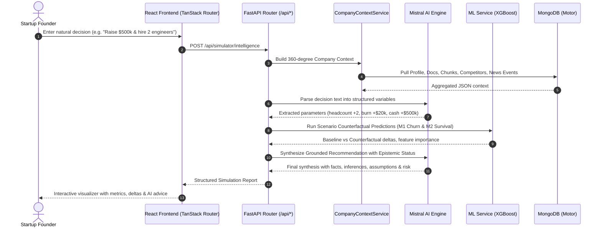

# Cofoundr OS: Master Technical Blueprint & Architecture Guide

Welcome to the **Cofoundr OS Blueprint**. This document serves as the single source of truth for engineering architecture, directory structures, file responsibilities, tech stack, feature workflows, and system interactions across the entire codebase.

---

## Table of Contents
1. [Executive Summary](#1-executive-summary)
2. [High-Level Architecture & System Flow](#2-high-level-architecture--system-flow)
3. [Technology Stack](#3-technology-stack)
4. [Project Directory & File-by-File Breakdown](#4-project-directory--file-by-file-breakdown)
   - [Root Directory Configuration](#root-directory-configuration)
   - [Backend Application (`backend/`)](#backend-application-backend)
   - [Machine Learning Subsystem (`ml/`)](#machine-learning-subsystem-ml)
   - [Startup Idea Validator (`backend/startup_validator/`)](#startup-idea-validator-backendstartup_validator)
   - [Frontend Application (`src/`)](#frontend-application-src)
5. [Feature-to-Code Mapping & Implementation Details](#5-feature-to-code-mapping--implementation-details)
   - [1. Conversational Startup Onboarding & Profile Extraction](#1-conversational-startup-onboarding--profile-extraction)
   - [2. Persistent Company Memory Vault (Document RAG)](#2-persistent-company-memory-vault-document-rag)
   - [3. AI Co-Founder Grounded Chat](#3-ai-co-founder-grounded-chat)
   - [4. Startup Health & Vulnerability Assessment](#4-startup-health--vulnerability-assessment)
   - [5. Competitor Discovery, Enrichment & Matrix](#5-competitor-discovery-enrichment--matrix)
   - [6. Strategic Opportunity Detection Engine](#6-strategic-opportunity-detection-engine)
   - [7. Persistent Deep Research & Intelligence Pipeline](#7-persistent-deep-research--intelligence-pipeline)
   - [8. Founder Decision Simulator & Scenario Engine](#8-founder-decision-simulator--scenario-engine)
   - [9. ML Predictive Inference (Revenue, Churn & Survival)](#9-ml-predictive-inference-revenue-churn--survival)
   - [10. Startup Idea Validator](#10-startup-idea-validator)
6. [Data Architecture & MongoDB Collections](#6-data-architecture--mongodb-collections)
7. [Authentication, Sessions & Guest Mode](#7-authentication-sessions--guest-mode)
8. [Configuration & Environment Variables](#8-configuration--environment-variables)
9. [Developer Setup, Running Locally & Deployment](#9-developer-setup-running-locally--deployment)

---

## 1. Executive Summary

**Cofoundr OS** is an AI Co-Founder platform and dynamic operating system for startup founders. Unlike stateless chat interfaces, Cofoundr OS retains a continuous, living state of the startup. It maintains a **25-field Company Profile**, indexes founder documents (pitch decks, business plans, financials) into a **Vector Knowledge Vault**, continuously tracks competitor maneuvers and market news through a **Deep Research Pipeline**, evaluates real-time **Startup Health Scores**, and provides a **Founder Decision Simulator** backed by trained Machine Learning models (RavenStack SaaS panel and 48,000-founder survival datasets).

---

## 2. High-Level Architecture & System Flow

```
┌─────────────────────────────────────────────────────────────────────────────────┐
│                           React 19 / TanStack Frontend                          │
│               (Vite + TanStack Router + TanStack Query + Tailwind CSS v4)        │
│                       Local Port: 5173  |  Prod: Vercel / Render                │
└───────────────────────────────────────┬─────────────────────────────────────────┘
                                        │ Vite Dev Proxy / Direct HTTP (`/api/*`)
                                        ▼
┌─────────────────────────────────────────────────────────────────────────────────┐
│                             FastAPI Backend Gateway                             │
│                  (Python 3.10+ / Uvicorn | Local Port: 8000 or 8001)             │
│                      Auth, Routers, Middlewares, Validation                     │
└──────────────┬────────────────────────┬─────────────────────────┬───────────────┘
               │                        │                         │
               ▼                        ▼                         ▼
┌──────────────────────────┐ ┌────────────────────┐ ┌───────────────────────────┐
│     MongoDB Database     │ │  ML Service Engine │ │       External APIs       │
│  (Motor Async Driver)    │ │ (XGBoost, Sklearn) │ │  - Mistral AI (LLM/Embed) │
│ - Users & Profiles       │ │ - Rev Forecast M1  │ │  - Tavily (Web Search)    │
│ - Documents & Chunks     │ │ - Churn Risk M1    │ │  - NewsData.io (News)     │
│ - Evidence & Insights    │ │ - Survival Risk M2 │ │                           │
└──────────────────────────┘ └────────────────────┘ └───────────────────────────┘
```

### End-to-End Decision & Intelligence Data Flow


---

## 3. Technology Stack

### Frontend
- **Runtime & Bundler**: [Node.js](https://nodejs.org/) / [Bun](https://bun.sh/), [Vite 8.1.5](https://vitejs.dev/)
- **Core Library**: [React 19.2.0](https://react.dev/), [TypeScript 5.8.3](https://www.typescriptlang.org/)
- **Routing**: [TanStack Router 1.170.18](https://tanstack.com/router) (file-based route tree generated via `@tanstack/router-plugin`)
- **Server Framework**: [TanStack Start 1.168.32](https://tanstack.com/start) with Nitro server integration
- **Data Fetching & Cache**: [TanStack Query 5.101.1](https://tanstack.com/query) (`@tanstack/react-query`)
- **Styling**: [Tailwind CSS v4](https://tailwindcss.com/) (`@tailwindcss/vite`), [tw-animate-css](https://www.npmjs.com/package/tw-animate-css)
- **UI Component Library**: [Radix UI Primitives](https://www.radix-ui.com/) (46 shadcn/ui style components), [Lucide React Icons](https://lucide.dev/)
- **Charts & Visualization**: [Recharts 2.15.4](https://recharts.org/)
- **Document Parsers (Client/SSR)**: [pdf-parse](https://www.npmjs.com/package/pdf-parse), [mammoth](https://www.npmjs.com/package/mammoth), [xlsx](https://www.npmjs.com/package/xlsx)
- **Notifications**: [Sonner](https://sonner.emilkowal.ski/)

### Backend
- **Framework**: [FastAPI 0.110+](https://fastapi.tiangolo.com/), [Uvicorn 0.28+](https://www.uvicorn.org/)
- **Database Driver**: [Motor 3.3.2](https://motor.readthedocs.io/) (Asynchronous MongoDB driver) + [PyMongo 4.6.2](https://pymongo.readthedocs.io/)
- **Validation & Serialization**: [Pydantic v2 (2.6.4)](https://docs.pydantic.dev/)
- **Authentication & Security**: [PyJWT 2.8.0](https://pyjwt.readthedocs.io/) (HS256 tokens), [Passlib / Bcrypt 4.1.2](https://passlib.readthedocs.io/)
- **Document Extraction (Server)**:
  - PDF: `pypdf 4.1.0`
  - DOCX: `python-docx 1.1.0`
  - PPTX: `python-pptx 0.6.23`
- **HTTP Client**: `httpx 0.27.0` for external API orchestration

### Machine Learning & Data Science
- **Libraries**: `xgboost`, `scikit-learn`, `joblib`, `pandas`, `numpy`
- **Models Loaded**:
  - `Model 1 - Revenue Forecast`: XGBoost Regressor (`decision_simulator_revenue_v1.json`) + Ridge Regression baseline
  - `Model 1 - Churn Risk`: XGBoost Classifier (`decision_simulator_churn_v1.json`) + Logistic Regression baseline
  - `Model 2 - Startup Survival Risk`: XGBoost Classifier (`decision_simulator_startup_risk_v1.json`) + Random Forest baseline
- **Registry**: `ml/model_registry.json`

### External AI & Data APIs
- **Mistral AI**:
  - `open-mistral-7b`, `ministral-8b-latest`, `mistral-small-latest`, `mistral-large-latest` for natural language reasoning, conversational onboarding, decision parsing, and synthesis.
  - `mistral-embed` (1024 dimensions) for Vector RAG embeddings.
  - *(Note: While legacy references or files like `gemini_service.py` mention Gemini, the platform is configured to run on Mistral AI).*
- **Tavily Search API**: High-accuracy web research, competitor discovery, domain scraping.
- **NewsData.io API**: Live business news, market trends, funding announcements, and press releases.

---

## 4. Project Directory & File-by-File Breakdown

```
founder-os/
├── backend/                  # FastAPI Python backend
│   ├── routers/              # HTTP Route endpoints
│   ├── services/             # Core business logic & orchestration
│   ├── startup_validator/    # Multi-stage startup idea analyzer
│   ├── tests/                # Automated backend tests
│   ├── auth.py               # JWT auth & guest session dependency
│   ├── config.py             # Settings & environment variables
│   ├── database.py           # Motor MongoDB client & index setup
│   ├── main.py               # FastAPI application entrypoint
│   ├── models.py             # Pydantic data schemas & models
│   └── requirements.txt      # Python dependencies
├── ml/                       # Machine Learning models, training scripts & registry
│   ├── data/                 # Training datasets
│   ├── models/               # Serialized model weights & encoders (.json, .joblib)
│   ├── reports/              # Model training evaluation reports
│   ├── src/                  # Model training code (Model 1 & Model 2)
│   └── model_registry.json   # Machine Learning metadata registry
├── src/                      # React 19 / TanStack Start frontend
│   ├── api/                  # SSR / Nitro API handlers
│   ├── components/           # OS & UI components
│   │   ├── os/               # Core application shell & OS widgets
│   │   └── ui/               # 46 Radix UI / Tailwind primitives
│   ├── hooks/                # Custom React hooks
│   ├── lib/                  # Shared stores, API client & utilities
│   ├── routes/               # 33 TanStack file-based routes
│   ├── routeTree.gen.ts      # Auto-generated routing tree
│   ├── router.tsx            # TanStack router initialization
│   ├── server.ts             # SSR server entry
│   ├── start.ts              # Client hydrate / start script
│   └── styles.css            # Tailwind CSS v4 stylesheets
├── uploads/                  # Temporary and uploaded documents storage
├── .env.example              # Sample environment configuration
├── package.json              # Frontend dependencies and npm scripts
├── render.yaml               # Render Infrastructure-as-Code deployment config
├── run.py                    # Root script to run Uvicorn backend
├── tsconfig.json             # TypeScript compiler settings & path aliases
└── vite.config.ts            # Vite bundler, TanStack plugins & API proxy
```

### Root Directory Configuration

| File | Purpose |
|---|---|
| [.env.example](file:///c:/Users/YOCKET-271/Documents/GitHub/founder-os/.env.example) | Template of required environment variables (`MISTRAL_API_KEY`, `MONGODB_URI`, `TAVILY_API_KEY`, etc.). |
| [package.json](file:///c:/Users/YOCKET-271/Documents/GitHub/founder-os/package.json) | Node package definitions, scripts (`dev`, `build`, `preview`, `lint`, `format`), dependencies. |
| [vite.config.ts](file:///c:/Users/YOCKET-271/Documents/GitHub/founder-os/vite.config.ts) | Vite build pipeline, `@tailwindcss/vite`, TanStack Router/Start plugins, and `/api` reverse proxy. |
| [tsconfig.json](file:///c:/Users/YOCKET-271/Documents/GitHub/founder-os/tsconfig.json) | TypeScript compiler options, JSX transform, and path mapping (`@/*` -> `./src/*`). |
| [run.py](file:///c:/Users/YOCKET-271/Documents/GitHub/founder-os/run.py) | Standalone Python launcher executing Uvicorn with port auto-detection (used in production containers). |
| [render.yaml](file:///c:/Users/YOCKET-271/Documents/GitHub/founder-os/render.yaml) | Blueprint configuration for deploying the FastAPI backend and React frontend to Render. |
| [Procfile](file:///c:/Users/YOCKET-271/Documents/GitHub/founder-os/Procfile) | Defines web process command for Heroku/Render (`web: python run.py`). |
| [components.json](file:///c:/Users/YOCKET-271/Documents/GitHub/founder-os/components.json) | shadcn/ui configuration defining the styles, Tailwind settings, and component aliases. |

---

### Backend Application (`backend/`)

#### Core Backend Files
| File | Lines / Size | Key Responsibilities |
|---|---|---|
| [backend/main.py](file:///c:/Users/YOCKET-271/Documents/GitHub/founder-os/backend/main.py) | 86 lines | Main FastAPI application instantiation, CORS configuration, startup hooks for MongoDB initialization and ML model preloading, router registrations. |
| [backend/config.py](file:///c:/Users/YOCKET-271/Documents/GitHub/founder-os/backend/config.py) | 26 lines | Centralized configuration via `Settings` class; loads environment variables, paths for upload directories, chunk size limits, and JWT secrets. |
| [backend/database.py](file:///c:/Users/YOCKET-271/Documents/GitHub/founder-os/backend/database.py) | 72 lines | Asynchronous MongoDB connection using `Motor`. Sets up database proxies, handles reconnects, and automatically creates indexes across 11+ collections. |
| [backend/models.py](file:///c:/Users/YOCKET-271/Documents/GitHub/founder-os/backend/models.py) | 312 lines | Complete Pydantic schemas: User, Token, 25-field `CompanyProfile`, `DocumentMeta`, `HealthReport`, `ChatMessage`, `CompetitorProfile`, `ResearchEvidence`, `ResearchInsight`, `ResearchRun`. |
| [backend/auth.py](file:///c:/Users/YOCKET-271/Documents/GitHub/founder-os/backend/auth.py) | 95 lines | Password hashing with bcrypt, JWT creation and decoding, FastAPI dependency `get_current_user` and `get_optional_current_user` (provides guest session fallback). |
| [backend/requirements.txt](file:///c:/Users/YOCKET-271/Documents/GitHub/founder-os/backend/requirements.txt) | 18 lines | Core Python pip dependencies (`fastapi`, `uvicorn`, `motor`, `pymongo`, `pydantic`, `pyjwt`, `pypdf`, etc.). |

#### Backend Routers (`backend/routers/`)
| File | Prefix / Tag | Responsibilities |
|---|---|---|
| [backend/routers/auth.py](file:///c:/Users/YOCKET-271/Documents/GitHub/founder-os/backend/routers/auth.py) | `/api/auth` | User registration, login, JWT token issuance, current user profile endpoint (`/me`). |
| [backend/routers/onboarding.py](file:///c:/Users/YOCKET-271/Documents/GitHub/founder-os/backend/routers/onboarding.py) | `/api/onboarding` | Conversational onboarding turns, natural language extraction into 25 profile fields, profile completeness calculation, reset and get profile state. |
| [backend/routers/documents.py](file:///c:/Users/YOCKET-271/Documents/GitHub/founder-os/backend/routers/documents.py) | `/api/documents` | Multipart file upload (.pdf, .docx, .txt, .pptx, .csv, .xlsx), document listing, deletion, classification, text extraction, chunking, and indexing. |
| [backend/routers/chat.py](file:///c:/Users/YOCKET-271/Documents/GitHub/founder-os/backend/routers/chat.py) | `/api/chat` | Grounded AI Co-founder chat interface, conversational history persistence, vector search chunk retrieval, context-augmented streaming replies. |
| [backend/routers/health.py](file:///c:/Users/YOCKET-271/Documents/GitHub/founder-os/backend/routers/health.py) | `/api/health` | Startup Health score calculation (0-100), 6 pillar breakdowns (Product, Market, GTM, Team, Financial, Legal/Ops), risk alerts, prescriptive action items. |
| [backend/routers/competitors.py](file:///c:/Users/YOCKET-271/Documents/GitHub/founder-os/backend/routers/competitors.py) | `/api/competitors` | Competitor discovery trigger, competitor profile retrieval, live Tavily enrichment, competitive comparison matrix, feature gap analysis. |
| [backend/routers/opportunities.py](file:///c:/Users/YOCKET-271/Documents/GitHub/founder-os/backend/routers/opportunities.py) | `/api/opportunities` | Generation of 5 strategic opportunities tailored to startup ICP & competitors, epistemic classification (facts, inferences, assumptions), roadmap promotion. |
| [backend/routers/research.py](file:///c:/Users/YOCKET-271/Documents/GitHub/founder-os/backend/routers/research.py) | `/api/research` | End-to-end research pipeline orchestrator; triggers NewsData + Tavily search, returns evidence, tracked entities, market events, insights, and run logs. |
| [backend/routers/simulator.py](file:///c:/Users/YOCKET-271/Documents/GitHub/founder-os/backend/routers/simulator.py) | `/api/simulator` | Natural language decision parsing, counterfactual scenario evaluation, baseline vs scenario predictions, decision coverage matrix, Stage 4 Decision Intelligence. |
| [backend/routers/ml_prediction.py](file:///c:/Users/YOCKET-271/Documents/GitHub/founder-os/backend/routers/ml_prediction.py) | `/api/ml` | Direct endpoints for Model 1 (RavenStack SaaS MRR forecast and churn probability) and Model 2 (Startup Survival risk index). |

#### Backend Services (`backend/services/`)
| File | Purpose |
|---|---|
| [backend/services/company_context_service.py](file:///c:/Users/YOCKET-271/Documents/GitHub/founder-os/backend/services/company_context_service.py) | Centralized 360-degree context engine. Merges 25-field profile, financial metrics, RAG document chunks, competitor intelligence, and research events into a unified context packet. |
| [backend/services/competitor_enrichment_service.py](file:///c:/Users/YOCKET-271/Documents/GitHub/founder-os/backend/services/competitor_enrichment_service.py) | Enriches raw competitor domains with web search data, pricing models, feature matrices, funding rounds, and positioning statements. |
| [backend/services/competitor_research_service.py](file:///c:/Users/YOCKET-271/Documents/GitHub/founder-os/backend/services/competitor_research_service.py) | Executes Tavily search queries based on the startup's problem and ICP to discover direct and indirect rivals. |
| [backend/services/decision_intelligence_service.py](file:///c:/Users/YOCKET-271/Documents/GitHub/founder-os/backend/services/decision_intelligence_service.py) | Orchestrates Stage 4 Decision Intelligence: builds company context, executes scenario engine + ML models, and prompts LLM to generate evidence-grounded strategic advice. |
| [backend/services/decision_parser_service.py](file:///c:/Users/YOCKET-271/Documents/GitHub/founder-os/backend/services/decision_parser_service.py) | Uses Mistral to decompose natural language founder decisions into structured financial, operational, and product variable adjustments. |
| [backend/services/doc_service.py](file:///c:/Users/YOCKET-271/Documents/GitHub/founder-os/backend/services/doc_service.py) | File metadata management, storage path resolution, and deletion cleanup. |
| [backend/services/document_processor.py](file:///c:/Users/YOCKET-271/Documents/GitHub/founder-os/backend/services/document_processor.py) | Multi-format text extractor (PDF, DOCX, PPTX, TXT, CSV, XLSX) and overlapping character chunker (`CHUNK_SIZE=1000`, `CHUNK_OVERLAP=200`). |
| [backend/services/evidence_processor_service.py](file:///c:/Users/YOCKET-271/Documents/GitHub/founder-os/backend/services/evidence_processor_service.py) | SHA-256 deduplication of research search results, extraction of named entities (competitors, investors, tech) and market events, and upserting into MongoDB. |
| [backend/services/gemini_service.py](file:///c:/Users/YOCKET-271/Documents/GitHub/founder-os/backend/services/gemini_service.py) | *(Configured with Mistral AI)* Powers the conversational onboarding dialogue with a YC-partner persona, progressive 4-level question framework, and JSON schema extraction. |
| [backend/services/health_engine.py](file:///c:/Users/YOCKET-271/Documents/GitHub/founder-os/backend/services/health_engine.py) | Algorithmic scoring engine computing 0-100 scores across 6 startup pillars, identifying critical data gaps and assigning actionable remediation steps. |
| [backend/services/ml_service.py](file:///c:/Users/YOCKET-271/Documents/GitHub/founder-os/backend/services/ml_service.py) | ML inference singleton. Loads and serves Model 1 (Revenue & Churn) and Model 2 (Startup Survival) using preloaded XGBoost JSON and Joblib encoders. |
| [backend/services/newsdata_service.py](file:///c:/Users/YOCKET-271/Documents/GitHub/founder-os/backend/services/newsdata_service.py) | Client for NewsData.io API fetching live industry news articles, headlines, and publication dates. |
| [backend/services/opportunities_generator_service.py](file:///c:/Users/YOCKET-271/Documents/GitHub/founder-os/backend/services/opportunities_generator_service.py) | Generates profile-tailored growth, product gap, and defensive opportunities with epistemic tagging (facts, inferences, assumptions) and fallback heuristic generation. |
| [backend/services/rag_service.py](file:///c:/Users/YOCKET-271/Documents/GitHub/founder-os/backend/services/rag_service.py) | Vector retrieval service. Generates embeddings via Mistral `mistral-embed` (1024 dims), queries MongoDB Atlas `$vectorSearch` with fallback in-memory cosine similarity. |
| [backend/services/research_insight_service.py](file:///c:/Users/YOCKET-271/Documents/GitHub/founder-os/backend/services/research_insight_service.py) | Synthesizes actionable strategic insights from collected news and web search evidence using a 4-question framework (What happened, Evidence, Why it matters, What to do). |
| [backend/services/research_pipeline_service.py](file:///c:/Users/YOCKET-271/Documents/GitHub/founder-os/backend/services/research_pipeline_service.py) | Orchestrator for background research runs (planning queries -> fetching news & search -> deduping -> extracting entities -> generating insights -> logging status). |
| [backend/services/research_planner_service.py](file:///c:/Users/YOCKET-271/Documents/GitHub/founder-os/backend/services/research_planner_service.py) | Formulates 3-5 high-yield search queries targeted to the startup's industry, ICP, competitors, and strategic priorities. |
| [backend/services/scenario_engine.py](file:///c:/Users/YOCKET-271/Documents/GitHub/founder-os/backend/services/scenario_engine.py) | Counterfactual simulation engine. Applies decision deltas to company state and runs ML models to calculate comparative outcomes (e.g. burn change, runway delta, survival probability). |
| [backend/services/web_search_service.py](file:///c:/Users/YOCKET-271/Documents/GitHub/founder-os/backend/services/web_search_service.py) | Tavily Search client executing targeted queries and retrieving snippets, titles, URLs, and domains. |

---

### Machine Learning Subsystem (`ml/`)

| File / Folder | Purpose |
|---|---|
| [ml/model_registry.json](file:///c:/Users/YOCKET-271/Documents/GitHub/founder-os/ml/model_registry.json) | Central registry documenting model IDs, paths, targets, performance metrics (MAE, RMSE, ROC-AUC, Brier scores), training datasets, and serving recommendations. |
| [ml/src/train_model1.py](file:///c:/Users/YOCKET-271/Documents/GitHub/founder-os/ml/src/train_model1.py) | Training pipeline for Model 1 on the RavenStack SaaS subscription dataset: trains XGBoost Regressor (MRR forecast) & XGBoost Classifier (churn risk) alongside Ridge/LogReg baselines. |
| [ml/src/train_model2.py](file:///c:/Users/YOCKET-271/Documents/GitHub/founder-os/ml/src/train_model2.py) | Training pipeline for Model 2 on 48,000 startup survival records: trains XGBoost Classifier for Day-0 terminal failure risk alongside Random Forest baselines. |
| [ml/models/](file:///c:/Users/YOCKET-271/Documents/GitHub/founder-os/ml/models/) | Saved artifacts: `decision_simulator_revenue_v1.json`, `decision_simulator_churn_v1.json`, `decision_simulator_startup_risk_v1.json`, label encoders, and feature importance CSVs. |
| [ml/data/](file:///c:/Users/YOCKET-271/Documents/GitHub/founder-os/ml/data/) | Raw and processed CSV datasets for SaaS analytics and founder survival benchmarks. |
| [ml/reports/](file:///c:/Users/YOCKET-271/Documents/GitHub/founder-os/ml/reports/) | Generated training metric summaries, confusion matrices, and feature importance reports. |

---

### Startup Idea Validator (`backend/startup_validator/`)

| File / Folder | Purpose |
|---|---|
| [backend/startup_validator/routes.py](file:///c:/Users/YOCKET-271/Documents/GitHub/founder-os/backend/startup_validator/routes.py) | Routes for idea analysis: `POST /analyze`, `GET /analyze/{job_id}`, `GET /results/{job_id}`. |
| [backend/startup_validator/service.py](file:///c:/Users/YOCKET-271/Documents/GitHub/founder-os/backend/startup_validator/service.py) | Asynchronous multi-stage job coordinator managing background threads, stage transitions, and persistence. |
| [backend/startup_validator/schemas.py](file:///c:/Users/YOCKET-271/Documents/GitHub/founder-os/backend/startup_validator/schemas.py) | Pydantic validation schemas for idea requests, progress bars, competitor scores, and final validation reports. |
| [backend/startup_validator/nlp/](file:///c:/Users/YOCKET-271/Documents/GitHub/founder-os/backend/startup_validator/nlp/) | Deconstructs unstructured startup ideas into Problem, Solution, Target Market, and Moat entities. |
| [backend/startup_validator/market/](file:///c:/Users/YOCKET-271/Documents/GitHub/founder-os/backend/startup_validator/market/) | Estimates TAM, SAM, SOM market sizing and industry CAGR rates. |
| [backend/startup_validator/competitors/](file:///c:/Users/YOCKET-271/Documents/GitHub/founder-os/backend/startup_validator/competitors/) | Identifies market saturation and existing incumbent alternatives. |
| [backend/startup_validator/validation/](file:///c:/Users/YOCKET-271/Documents/GitHub/founder-os/backend/startup_validator/validation/) | Evaluates problem urgency, founder-market fit, and technical viability heuristics. |
| [backend/startup_validator/recommendation/](file:///c:/Users/YOCKET-271/Documents/GitHub/founder-os/backend/startup_validator/recommendation/) | Synthesizes an overall Go/Pivot/No-Go score and recommended initial MVP experiments. |

---

### Frontend Application (`src/`)

#### Client State & Core Utilities (`src/lib/` & `src/hooks/`)
| File | Purpose |
|---|---|
| [src/lib/api-client.ts](file:///c:/Users/YOCKET-271/Documents/GitHub/founder-os/src/lib/api-client.ts) | Typed frontend HTTP API client that wraps `fetch`, attaches JWT Bearer tokens from local storage, handles errors, and connects to `/api/*` endpoints. |
| [src/lib/os-store.tsx](file:///c:/Users/YOCKET-271/Documents/GitHub/founder-os/src/lib/os-store.tsx) | Global React context (`OsProvider`, `useOs`) managing company profile state, health report, tasks, activities, and local storage synchronization. |
| [src/lib/auth-context.tsx](file:///c:/Users/YOCKET-271/Documents/GitHub/founder-os/src/lib/auth-context.tsx) | Authentication context provider tracking current user session, tokens, login, and logout state. |
| [src/lib/company-data.ts](file:///c:/Users/YOCKET-271/Documents/GitHub/founder-os/src/lib/company-data.ts) | Baseline and benchmark company data definitions, default profiles, financial projections, and seed industry presets. |
| [src/lib/chunker.ts](file:///c:/Users/YOCKET-271/Documents/GitHub/founder-os/src/lib/chunker.ts) | Frontend text chunking utility used for client-side document preprocessing. |
| [src/lib/mistral.ts](file:///c:/Users/YOCKET-271/Documents/GitHub/founder-os/src/lib/mistral.ts) | Direct Mistral API helper for SSR or client-side generative fallbacks. |
| [src/lib/db.ts](file:///c:/Users/YOCKET-271/Documents/GitHub/founder-os/src/lib/db.ts) | Direct MongoDB client for TanStack Start Nitro server-side API functions. |
| [src/lib/utils.ts](file:///c:/Users/YOCKET-271/Documents/GitHub/founder-os/src/lib/utils.ts) | Utility helper function `cn(...)` combining `clsx` and `tailwind-merge`. |
| [src/lib/error-capture.ts](file:///c:/Users/YOCKET-271/Documents/GitHub/founder-os/src/lib/error-capture.ts) | Global error listener and logging capture utility. |
| [src/lib/error-page.ts](file:///c:/Users/YOCKET-271/Documents/GitHub/founder-os/src/lib/error-page.ts) | Error boundary view component displayed when critical render errors occur. |
| [src/hooks/use-mobile.tsx](file:///c:/Users/YOCKET-271/Documents/GitHub/founder-os/src/hooks/use-mobile.tsx) | React hook detecting viewport widths below mobile thresholds (`< 768px`). |

#### OS UI Components (`src/components/os/`)
| File | Purpose |
|---|---|
| [src/components/os/app-shell.tsx](file:///c:/Users/YOCKET-271/Documents/GitHub/founder-os/src/components/os/app-shell.tsx) | The primary application layout: collapsible sidebar with active badges, top command bar, breadcrumbs, search dialog (`cmdk`), notifications dropdown, and quick profile switcher. |
| [src/components/os/ai-sphere.tsx](file:///c:/Users/YOCKET-271/Documents/GitHub/founder-os/src/components/os/ai-sphere.tsx) | Animated glowing 3D/canvas AI Co-founder sphere avatar that visually pulses during AI reasoning, streaming, and pipeline tasks. |
| [src/components/os/recommendation-card.tsx](file:///c:/Users/YOCKET-271/Documents/GitHub/founder-os/src/components/os/recommendation-card.tsx) | Interactive decision/recommendation card component with epistemic badges (Fact, Inference, Assumption), impact indicators, and action triggers. |
| [src/components/os/primitives.tsx](file:///c:/Users/YOCKET-271/Documents/GitHub/founder-os/src/components/os/primitives.tsx) | Specialized Founder OS UI primitives (metric stat cards, pill indicators, stage tags, and glassmorphic panels). |

#### Frontend Routes (`src/routes/`)
| Route File | URL Path | View Description |
|---|---|---|
| [src/routes/__root.tsx](file:///c:/Users/YOCKET-271/Documents/GitHub/founder-os/src/routes/__root.tsx) | Root | Root layout wrapper; provides HTML head tags, fonts, theme context, and Sonner toaster. |
| [src/routes/index.tsx](file:///c:/Users/YOCKET-271/Documents/GitHub/founder-os/src/routes/index.tsx) | `/` | High-converting marketing landing page with hero demo, feature grid, and live OS previews. |
| [src/routes/auth.tsx](file:///c:/Users/YOCKET-271/Documents/GitHub/founder-os/src/routes/auth.tsx) | `/auth` | Authentication portal (Sign In and Sign Up tabs) managing JWT storage. |
| [src/routes/onboarding.tsx](file:///c:/Users/YOCKET-271/Documents/GitHub/founder-os/src/routes/onboarding.tsx) | `/onboarding` | Conversational YC-style onboarding chat with real-time extracted profile preview cards and completeness dial. |
| [src/routes/app.tsx](file:///c:/Users/YOCKET-271/Documents/GitHub/founder-os/src/routes/app.tsx) | `/app` | Authenticated layout shell rendering `AppShell` with nested `<Outlet />`. |
| [src/routes/app.index.tsx](file:///c:/Users/YOCKET-271/Documents/GitHub/founder-os/src/routes/app.index.tsx) | `/app` | Executive Overview: Health score, runway countdown, critical action items, and recent market alerts. |
| [src/routes/app.dashboard.tsx](file:///c:/Users/YOCKET-271/Documents/GitHub/founder-os/src/routes/app.dashboard.tsx) | `/app/dashboard` | Main Startup Dashboard: Financial charts, MRR tracking, runway burn rates, and milestone checklist. |
| [src/routes/app.chat.tsx](file:///c:/Users/YOCKET-271/Documents/GitHub/founder-os/src/routes/app.chat.tsx) | `/app/chat` | AI Co-Founder Chat: Multi-turn grounded chat with citations, source snippets, and document attachment support. |
| [src/routes/app.simulator.tsx](file:///c:/Users/YOCKET-271/Documents/GitHub/founder-os/src/routes/app.simulator.tsx) | `/app/simulator` | Founder Decision Simulator: Natural language decision input, scenario sliders, baseline vs scenario comparative metrics, ML risk indicators, and AI Co-founder synthesis. |
| [src/routes/app.opportunities.tsx](file:///c:/Users/YOCKET-271/Documents/GitHub/founder-os/src/routes/app.opportunities.tsx) | `/app/opportunities` | Opportunity Matrix: Strategic growth and defensive opportunities with epistemic evidence breakdowns (facts, inferences, assumptions) and roadmap promotion. |
| [src/routes/app.research.tsx](file:///c:/Users/YOCKET-271/Documents/GitHub/founder-os/src/routes/app.research.tsx) | `/app/research` | Deep Research Center: Trigger intelligence runs, view search queries, live logs, discovered evidence cards, tracked market entities, and synthesized insights. |
| [src/routes/app.competitors.tsx](file:///c:/Users/YOCKET-271/Documents/GitHub/founder-os/src/routes/app.competitors.tsx) | `/app/competitors` | Competitor Intelligence: Competitor directory, positioning maps, SWOT analysis, and feature gap comparison table. |
| [src/routes/app.competitors.$id.tsx](file:///c:/Users/YOCKET-271/Documents/GitHub/founder-os/src/routes/app.competitors.$id.tsx) | `/app/competitors/:id` | Individual Competitor Profile: Deep dive into pricing, traffic, features, and source citations for a specific competitor. |
| [src/routes/app.health.tsx](file:///c:/Users/YOCKET-271/Documents/GitHub/founder-os/src/routes/app.health.tsx) | `/app/health` | Startup Health Report: 6-pillar radar score, detailed breakdown of verified vs missing data, vulnerability warnings, and remediation actions. |
| [src/routes/app.knowledge.tsx](file:///c:/Users/YOCKET-271/Documents/GitHub/founder-os/src/routes/app.knowledge.tsx) | `/app/knowledge` | Knowledge Vault: Drag-and-drop document upload (.pdf, .docx, .txt), chunk inspection, indexing status, and category reclassification. |
| [src/routes/app.profile.tsx](file:///c:/Users/YOCKET-271/Documents/GitHub/founder-os/src/routes/app.profile.tsx) | `/app/profile` | 25-Field Company Profile: Full interactive viewer and editor for company details, team, validation, business model, and strategic goals. |
| [src/routes/app.workspace.tsx](file:///c:/Users/YOCKET-271/Documents/GitHub/founder-os/src/routes/app.workspace.tsx) | `/app/workspace` | Founder Workspace: Unified command desk organizing active priorities, sticky notes, and open decisions. |
| [src/routes/app.forecast.tsx](file:///c:/Users/YOCKET-271/Documents/GitHub/founder-os/src/routes/app.forecast.tsx) | `/app/forecast` | ML-driven revenue and financial forecasting dashboard with confidence intervals. |
| [src/routes/app.validation.tsx](file:///c:/Users/YOCKET-271/Documents/GitHub/founder-os/src/routes/app.validation.tsx) | `/app/validation` | Idea Validator: Input new startup concepts, view multi-stage validation progress, and inspect final validation reports. |
| [src/routes/app.runway.tsx](file:///c:/Users/YOCKET-271/Documents/GitHub/founder-os/src/routes/app.runway.tsx) | `/app/runway` | Financial Runway Calculator: Cash balance, burn rate modeling, and "zero cash date" projections. |
| [src/routes/app.metrics.tsx](file:///c:/Users/YOCKET-271/Documents/GitHub/founder-os/src/routes/app.metrics.tsx) | `/app/metrics` | SaaS Metrics: MRR, ARR, churn rate, LTV, CAC, and expansion revenue tracking. |
| [src/routes/app.investors.tsx](file:///c:/Users/YOCKET-271/Documents/GitHub/founder-os/src/routes/app.investors.tsx) | `/app/investors` | Investor CRM: Track fundraising stages, target venture capitalists, and pitch interactions. |
| [src/routes/app.roadmap.tsx](file:///c:/Users/YOCKET-271/Documents/GitHub/founder-os/src/routes/app.roadmap.tsx) | `/app/roadmap` | Strategic Timeline: Milestone planner organizing accepted opportunities into quarterly horizons. |
| [src/routes/app.tasks.tsx](file:///c:/Users/YOCKET-271/Documents/GitHub/founder-os/src/routes/app.tasks.tsx) | `/app/tasks` | Operational Task Board: Kanban-style task tracker for founder action items. |
| [src/routes/app.agents.tsx](file:///c:/Users/YOCKET-271/Documents/GitHub/founder-os/src/routes/app.agents.tsx) | `/app/agents` | Agent Squad Hub: Status monitor for background AI agents (Research Agent, Health Monitor, Opportunity Scout). |
| [src/routes/app.deck.tsx](file:///c:/Users/YOCKET-271/Documents/GitHub/founder-os/src/routes/app.deck.tsx) | `/app/deck` | Pitch Deck Reviewer: Slide-by-slide constructive critique against YC pitching standards. |
| [src/routes/app.reasoning.tsx](file:///c:/Users/YOCKET-271/Documents/GitHub/founder-os/src/routes/app.reasoning.tsx) | `/app/reasoning` | Epistemic Reasoning Graph: Explores facts, inferences, and assumptions underpinning AI advice. |
| [src/routes/app.graph.tsx](file:///c:/Users/YOCKET-271/Documents/GitHub/founder-os/src/routes/app.graph.tsx) | `/app/graph` | Knowledge Graph: Interactive node visualization linking company entities, competitors, documents, and market events. |
| [src/routes/app.learning.tsx](file:///c:/Users/YOCKET-271/Documents/GitHub/founder-os/src/routes/app.learning.tsx) | `/app/learning` | Founder Playbooks: Curated startup knowledge, fundraising guides, and pricing frameworks. |
| [src/routes/app.timeline.tsx](file:///c:/Users/YOCKET-271/Documents/GitHub/founder-os/src/routes/app.timeline.tsx) | `/app/timeline` | Activity Audit Log: Chronological timeline of company updates, documents indexed, and decisions simulated. |
| [src/routes/app.settings.tsx](file:///c:/Users/YOCKET-271/Documents/GitHub/founder-os/src/routes/app.settings.tsx) | `/app/settings` | Settings: Workspace preferences, API key overrides, team member invites, and profile data export/reset. |

---

## 5. Feature-to-Code Mapping & Implementation Details

### 1. Conversational Startup Onboarding & Profile Extraction
- **Frontend View**: [src/routes/onboarding.tsx](file:///c:/Users/YOCKET-271/Documents/GitHub/founder-os/src/routes/onboarding.tsx)
- **Frontend API**: [src/api/onboarding.ts](file:///c:/Users/YOCKET-271/Documents/GitHub/founder-os/src/api/onboarding.ts) & [src/lib/api-client.ts](file:///c:/Users/YOCKET-271/Documents/GitHub/founder-os/src/lib/api-client.ts)
- **Backend Router**: [backend/routers/onboarding.py](file:///c:/Users/YOCKET-271/Documents/GitHub/founder-os/backend/routers/onboarding.py)
- **Core Service**: [backend/services/gemini_service.py](file:///c:/Users/YOCKET-271/Documents/GitHub/founder-os/backend/services/gemini_service.py) (Mistral LLM extraction)
- **Data Model**: `CompanyProfile` (25 fields) in [backend/models.py](file:///c:/Users/YOCKET-271/Documents/GitHub/founder-os/backend/models.py)
- **Workflow**:
  1. Founder enters chat responses describing their startup.
  2. The LLM acts as an experienced YC Partner using a strict 4-level progressive priority framework:
     - Level 1: Core understanding (`company_name`, `product`, `industry`, `problem_statement`, `target_customer`, `solution`)
     - Level 2: Startup context (`current_stage`, `validation_done`, `team_size`, `traction`, `competitors`)
     - Level 3: Business model (`business_model`, `revenue_model`, `website`, `location`)
     - Level 4: Strategic vision (`current_challenges`, `short_term_goals`, `long_term_vision`)
  3. Every turn updates the MongoDB `profiles` collection and increments `profile_completeness` (0-100%).

### 2. Persistent Company Memory Vault (Document RAG)
- **Frontend View**: [src/routes/app.knowledge.tsx](file:///c:/Users/YOCKET-271/Documents/GitHub/founder-os/src/routes/app.knowledge.tsx)
- **Backend Router**: [backend/routers/documents.py](file:///c:/Users/YOCKET-271/Documents/GitHub/founder-os/backend/routers/documents.py)
- **Core Services**: [backend/services/document_processor.py](file:///c:/Users/YOCKET-271/Documents/GitHub/founder-os/backend/services/document_processor.py), [backend/services/rag_service.py](file:///c:/Users/YOCKET-271/Documents/GitHub/founder-os/backend/services/rag_service.py)
- **Database Collections**: `documents` (metadata) and `chunks` (text chunks + vector embeddings).
- **Workflow**:
  1. Files uploaded via multipart form. Supports PDF (`pypdf`), DOCX (`python-docx`), PPTX (`python-pptx`), TXT, CSV, and XLSX.
  2. Split into chunks (`CHUNK_SIZE=1000` chars, `CHUNK_OVERLAP=200`).
  3. Embedded using Mistral `mistral-embed` (1024 dimensions).
  4. Stored in MongoDB with index `[user_id, document_id]`.
  5. Vector retrieval queries MongoDB Atlas `$vectorSearch` with automatic fallback to in-memory cosine similarity calculation if Atlas vector indexes are unconfigured.

### 3. AI Co-Founder Grounded Chat
- **Frontend View**: [src/routes/app.chat.tsx](file:///c:/Users/YOCKET-271/Documents/GitHub/founder-os/src/routes/app.chat.tsx)
- **Backend Router**: [backend/routers/chat.py](file:///c:/Users/YOCKET-271/Documents/GitHub/founder-os/backend/routers/chat.py)
- **Core Services**: [backend/services/rag_service.py](file:///c:/Users/YOCKET-271/Documents/GitHub/founder-os/backend/services/rag_service.py), [backend/services/company_context_service.py](file:///c:/Users/YOCKET-271/Documents/GitHub/founder-os/backend/services/company_context_service.py)
- **Workflow**:
  1. User message triggers query embedding.
  2. Relevant document chunks are retrieved from the knowledge vault.
  3. Context is assembled with the 25-field company profile.
  4. Response is generated by Mistral, citing specific source filenames and document sections.

### 4. Startup Health & Vulnerability Assessment
- **Frontend View**: [src/routes/app.health.tsx](file:///c:/Users/YOCKET-271/Documents/GitHub/founder-os/src/routes/app.health.tsx)
- **Backend Router**: [backend/routers/health.py](file:///c:/Users/YOCKET-271/Documents/GitHub/founder-os/backend/routers/health.py)
- **Core Service**: [backend/services/health_engine.py](file:///c:/Users/YOCKET-271/Documents/GitHub/founder-os/backend/services/health_engine.py)
- **Data Model**: `HealthReport`, `HealthComponent` in [backend/models.py](file:///c:/Users/YOCKET-271/Documents/GitHub/founder-os/backend/models.py)
- **Workflow**:
  1. Algorithmic analysis of profile completeness, runway months, customer validation proof, and team balance.
  2. Evaluates 6 pillars: Product, Market, Go-to-Market, Team, Financial Health, and Legal/Operations.
  3. Generates 0-100 pillar scores, flags high-risk vulnerabilities, and outputs step-by-step corrective actions.

### 5. Competitor Discovery, Enrichment & Matrix
- **Frontend Views**: [src/routes/app.competitors.tsx](file:///c:/Users/YOCKET-271/Documents/GitHub/founder-os/src/routes/app.competitors.tsx) & [src/routes/app.competitors.$id.tsx](file:///c:/Users/YOCKET-271/Documents/GitHub/founder-os/src/routes/app.competitors.$id.tsx)
- **Backend Router**: [backend/routers/competitors.py](file:///c:/Users/YOCKET-271/Documents/GitHub/founder-os/backend/routers/competitors.py)
- **Core Services**: [backend/services/competitor_research_service.py](file:///c:/Users/YOCKET-271/Documents/GitHub/founder-os/backend/services/competitor_research_service.py), [backend/services/competitor_enrichment_service.py](file:///c:/Users/YOCKET-271/Documents/GitHub/founder-os/backend/services/competitor_enrichment_service.py)
- **External Integration**: Tavily Web Search API
- **Workflow**:
  1. Searches for direct/indirect competitors using startup problem and ICP keywords.
  2. Scrapes competitor websites to extract value propositions, pricing tiers, and target users.
  3. Synthesizes a structured competitor profile with SWOT analysis and competitive gaps.

### 6. Strategic Opportunity Detection Engine
- **Frontend View**: [src/routes/app.opportunities.tsx](file:///c:/Users/YOCKET-271/Documents/GitHub/founder-os/src/routes/app.opportunities.tsx)
- **Backend Router**: [backend/routers/opportunities.py](file:///c:/Users/YOCKET-271/Documents/GitHub/founder-os/backend/routers/opportunities.py)
- **Core Service**: [backend/services/opportunities_generator_service.py](file:///c:/Users/YOCKET-271/Documents/GitHub/founder-os/backend/services/opportunities_generator_service.py)
- **Epistemic Classification**:
  - **Facts**: Verified signals directly from customer interviews, competitor teardowns, or documents.
  - **Inferences**: Logical deductions drawn from combining multiple facts.
  - **Assumptions**: Critical unvalidated hypotheses that must be tested before major capital expenditure.
- **Workflow**:
  1. Generates 5 tailored opportunities across feature gaps, pricing adjustments, expansion, and moat building.
  2. Founder can inspect evidence, accept opportunities, and promote them directly into the strategic roadmap.

### 7. Persistent Deep Research & Intelligence Pipeline
- **Frontend View**: [src/routes/app.research.tsx](file:///c:/Users/YOCKET-271/Documents/GitHub/founder-os/src/routes/app.research.tsx)
- **Backend Router**: [backend/routers/research.py](file:///c:/Users/YOCKET-271/Documents/GitHub/founder-os/backend/routers/research.py)
- **Core Services**:
  - Orchestration: [backend/services/research_pipeline_service.py](file:///c:/Users/YOCKET-271/Documents/GitHub/founder-os/backend/services/research_pipeline_service.py)
  - Planning: [backend/services/research_planner_service.py](file:///c:/Users/YOCKET-271/Documents/GitHub/founder-os/backend/services/research_planner_service.py)
  - Evidence & Entity Extraction: [backend/services/evidence_processor_service.py](file:///c:/Users/YOCKET-271/Documents/GitHub/founder-os/backend/services/evidence_processor_service.py)
  - Insights Synthesis: [backend/services/research_insight_service.py](file:///c:/Users/YOCKET-271/Documents/GitHub/founder-os/backend/services/research_insight_service.py)
  - Search APIs: [backend/services/newsdata_service.py](file:///c:/Users/YOCKET-271/Documents/GitHub/founder-os/backend/services/newsdata_service.py) & [backend/services/web_search_service.py](file:///c:/Users/YOCKET-271/Documents/GitHub/founder-os/backend/services/web_search_service.py)
- **Database Collections**: `research_runs`, `research_evidence`, `research_entities`, `research_events`, `research_insights`.
- **Workflow**:
  1. Generates targeted search queries based on startup industry and priorities.
  2. Queries NewsData.io and Tavily.
  3. Computes SHA-256 content hashes to deduplicate evidence.
  4. Extracts named entities and events (funding, launches, regulations).
  5. Answers 4 core questions: What happened? What is the evidence? Why does this matter to this startup? What should the founder do?

### 8. Founder Decision Simulator & Scenario Engine
- **Frontend View**: [src/routes/app.simulator.tsx](file:///c:/Users/YOCKET-271/Documents/GitHub/founder-os/src/routes/app.simulator.tsx)
- **Backend Router**: [backend/routers/simulator.py](file:///c:/Users/YOCKET-271/Documents/GitHub/founder-os/backend/routers/simulator.py)
- **Core Services**:
  - Parsing: [backend/services/decision_parser_service.py](file:///c:/Users/YOCKET-271/Documents/GitHub/founder-os/backend/services/decision_parser_service.py)
  - Simulation: [backend/services/scenario_engine.py](file:///c:/Users/YOCKET-271/Documents/GitHub/founder-os/backend/services/scenario_engine.py)
  - Stage 4 Intelligence: [backend/services/decision_intelligence_service.py](file:///c:/Users/YOCKET-271/Documents/GitHub/founder-os/backend/services/decision_intelligence_service.py)
- **Decision Coverage Matrix**:
  - `SUPPORTED (Model-Powered)`: Fundraising (`funding_path`, `runway_months`), Burn adjustments (`monthly_burn_rate`), Validation actions (`did_customer_validation`).
  - `PARTIALLY_SUPPORTED`: Pricing changes (`account_plan_tier`), Hiring (`monthly_burn_rate`, `team_completeness`), Feature launches (`has_beta_feature`).
  - `UNSUPPORTED (Rule-Based Fallback)`: Geographic expansion, pure marketing ad spend.
- **Workflow**:
  1. Founder enters natural language decision: *"Raise $500k at $20k monthly burn and hire 2 engineers"*.
  2. LLM extracts parameter deltas.
  3. `ScenarioEngine` simulates baseline vs counterfactual metrics.
  4. Runs Model 1 (Revenue & Churn) and Model 2 (Survival Risk).
  5. `DecisionIntelligenceService` combines scenario output with document evidence to synthesize a grounded co-founder recommendation.

### 9. ML Predictive Inference (Revenue, Churn & Survival)
- **Backend Router**: [backend/routers/ml_prediction.py](file:///c:/Users/YOCKET-271/Documents/GitHub/founder-os/backend/routers/ml_prediction.py)
- **Core Service**: [backend/services/ml_service.py](file:///c:/Users/YOCKET-271/Documents/GitHub/founder-os/backend/services/ml_service.py)
- **Registry**: [ml/model_registry.json](file:///c:/Users/YOCKET-271/Documents/GitHub/founder-os/ml/model_registry.json)
- **Models**:
  - **Model 1 (Revenue Forecast & Churn Risk)**:
    - Target 1: `next_month_mrr` (XGBRegressor + Ridge baseline).
    - Target 2: `target_churn_event_t1` (XGBClassifier + LogReg baseline).
    - Dataset: RavenStack SaaS panel.
  - **Model 2 (Startup Survival Risk)**:
    - Target: `failed` (XGBClassifier + Random Forest baseline).
    - Top predictive feature: `did_customer_validation`, followed by `runway_months` and `monthly_burn_rate`.
    - Dataset: 48,000 Day-0 founder survival dataset.

### 10. Startup Idea Validator
- **Frontend View**: [src/routes/app.validation.tsx](file:///c:/Users/YOCKET-271/Documents/GitHub/founder-os/src/routes/app.validation.tsx)
- **Backend Router**: [backend/startup_validator/routes.py](file:///c:/Users/YOCKET-271/Documents/GitHub/founder-os/backend/startup_validator/routes.py)
- **Core Service**: [backend/startup_validator/service.py](file:///c:/Users/YOCKET-271/Documents/GitHub/founder-os/backend/startup_validator/service.py)
- **Workflow**:
  1. Accepts an unvetted startup idea string.
  2. Spawns asynchronous multi-stage evaluation (NLP decomposition -> Market sizing -> Competitor density -> Validation scoring -> Recommendation synthesis).
  3. Provides polling endpoints (`GET /analyze/{job_id}`) and returns structured validation scores, risks, and recommended initial experiments.

---

## 6. Data Architecture & MongoDB Collections

All persistent data is stored in MongoDB (database name: `cofoundr_os`).

| Collection Name | Key Schema Fields | Indexes Configured |
|---|---|---|
| `users` | `_id`, `email`, `username`, `password` (bcrypt hash), `created_at` | `email` (unique), `username` (unique) |
| `profiles` | `user_id`, `company_name`, `one_line_pitch`, `product`, `target_customer`, `industry`, `problem_statement`, `solution`, `business_model`, `current_stage`, `validation_done`, `validation_details`, `profile_completeness`, `monthly_revenue`, `runway_months`, etc. (25 fields) | `user_id` (unique) |
| `documents` | `_id`, `user_id`, `filename`, `category`, `short_summary`, `fileSizeBytes`, `chunkCount`, `status`, `uploadedAt` | `[user_id, uploadedAt]` |
| `chunks` | `_id`, `document_id`, `user_id`, `chunk_index`, `text`, `embedding` (1024 float array) | `[user_id, document_id]` |
| `conversations` | `_id`, `user_id`, `messages` (`role`, `content`, `timestamp`), `updated_at` | `user_id` |
| `chat_conversations` | `_id`, `user_id`, `messages`, `conversation_id`, `updated_at` | `user_id` |
| `health_reports` | `_id`, `user_id`, `overall_score`, `status`, `components` (6 pillars), `missing_areas`, `recommendations`, `calculated_at` | `user_id` |
| `competitor_research`| `_id`, `user_id`, `competitors` (list), `comparison`, `gaps`, `research_status`, `started_at` | `user_id` |
| `research_runs` | `id`, `user_id`, `status`, `queries_used`, `evidence_found`, `insights_generated`, `started_at`, `pipeline_log` | `[user_id, started_at]` |
| `research_evidence` | `id`, `user_id`, `url`, `title`, `snippet`, `source_type`, `domain`, `content_hash`, `retrieved_at` | `[user_id, content_hash]` (unique), `[user_id, retrieved_at]` |
| `research_entities` | `id`, `user_id`, `canonical_name`, `entity_type`, `mention_count`, `relevance_score`, `first_seen_at` | `[user_id, canonical_name, entity_type]` (unique), `[user_id, relevance_score]` |
| `research_events` | `id`, `user_id`, `event_type`, `title`, `entities_involved`, `evidence_ids`, `relevance_score`, `created_at` | `[user_id, created_at]`, `[user_id, relevance_score]` |
| `research_insights` | `id`, `user_id`, `what_happened`, `evidence_summary`, `why_it_matters`, `what_to_do`, `confidence`, `relevance_score` | `[user_id, created_at]`, `[user_id, relevance_score]`, `[user_id, impact_area]` |

---

## 7. Authentication, Sessions & Guest Mode

The platform provides a dual-layer authentication strategy to accommodate authenticated users while offering a frictionless guest trial experience:

1. **JWT Authentication**:
   - Implemented in [backend/auth.py](file:///c:/Users/YOCKET-271/Documents/GitHub/founder-os/backend/auth.py).
   - Algorithm: `HS256`, 7-day token expiration (`JWT_EXPIRATION_MINUTES = 60 * 24 * 7`).
   - Tokens stored in browser `localStorage` as `cofoundr_token`.
2. **Guest Session Mode**:
   - `get_optional_current_user` extracts the JWT Bearer header if present.
   - If the header is missing, malformed, or unauthenticated, it returns a persistent mock guest identity:
     ```python
     {
         "id": "guest_session_user",
         "email": "guest@cofoundr.os",
         "username": "guest_founder",
         "created_at": datetime.utcnow()
     }
     ```
   - This ensures all features (chat, onboarding, RAG uploads, decision simulations) work immediately out of the box without requiring upfront registration.

---

## 8. Configuration & Environment Variables

Environment variables are managed in `.env` at the project root:

```env
# ── AI API Credentials ────────────────────────────────────────────────
# Mistral AI Developer API Key (required for reasoning, extraction & vector embeddings)
MISTRAL_API_KEY=your_mistral_api_key_here

# ── Database ──────────────────────────────────────────────────────────
# MongoDB Connection URI (Local MongoDB or MongoDB Atlas)
MONGODB_URI=mongodb://localhost:27017
MONGODB_DB_NAME=cofoundr_os

# ── Web Research & News APIs ──────────────────────────────────────────
# Tavily Search API (for live web search & competitor scraping)
TAVILY_API_KEY=your_tavily_api_key_here

# NewsData.io API (for market news & funding updates)
NEWSDATA_API_KEY=your_newsdata_api_key_here

# ── Security & Authentication ─────────────────────────────────────────
JWT_SECRET=cofoundr_super_secret_jwt_key_2026

# ── Network & Deployment ──────────────────────────────────────────────
# Allowed origins for FastAPI CORS (leave empty for default localhost permissions)
CORS_ORIGINS=http://localhost:5173,http://localhost:3000

# Remote backend URL for frontend (set when deploying frontend to Vercel/Render)
VITE_API_URL=http://localhost:8000
```

---

## 9. Developer Setup, Running Locally & Deployment

### Prerequisites
- Node.js 20+ or Bun 1.1+
- Python 3.10+
- MongoDB 6.0+ (running locally on port `27017` or a free MongoDB Atlas cluster)

### Step 1: Install Dependencies
```bash
# Install frontend packages
npm install

# Install backend packages
pip install -r backend/requirements.txt
```

### Step 2: Configure Environment
Copy `.env.example` to `.env` and provide your API keys:
```bash
cp .env.example .env
```

### Step 3: Run the Local Development Environment
The application requires running both the FastAPI backend and the Vite dev server.

**Terminal 1 (Backend - FastAPI)**:
```bash
# Run with Uvicorn (port 8000 or 8001)
uvicorn backend.main:app --host 0.0.0.0 --port 8000 --reload
# Or run using the launcher
python run.py
```

**Terminal 2 (Frontend - Vite / TanStack Start)**:
```bash
npm run dev
```
Open your browser at `http://localhost:5173`. Requests made to `/api/*` are automatically forwarded to the backend.

### Production Deployment
- **Backend (Render / Railway / Docker)**:
  - Build command: `pip install -r backend/requirements.txt`
  - Start command: `python run.py` (or `uvicorn backend.main:app --host 0.0.0.0 --port $PORT`)
  - Configured via [render.yaml](file:///c:/Users/YOCKET-271/Documents/GitHub/founder-os/render.yaml).
- **Frontend (Vercel / Render Static Web Service)**:
  - Build command: `npm run build`
  - Output directory: `dist`
  - Environment variable: `VITE_API_URL=https://your-backend.onrender.com`
