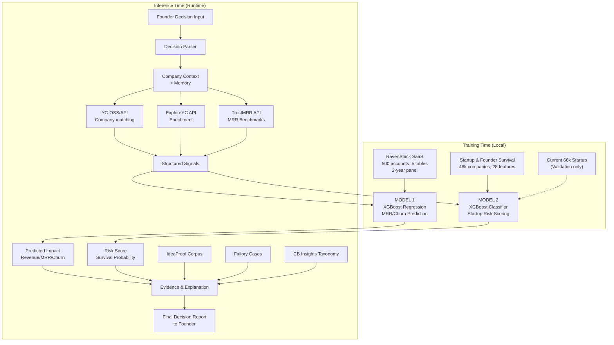

# Data Acquisition & Dataset Comparison Report

**Location**: `ml/reports/data_acquisition_comparison.md`  
**Report Date**: September 9, 2026  
**Scope**: Dataset finalization for Decision Simulator ML Prediction Layer  
**Status**: Research complete — awaiting user review before training

---

## 1. Executive Recommendation

> [!IMPORTANT]
> **The current dataset combination is inadequate for the intended Decision Simulator architecture.** The SaaS Business Metrics dataset is synthetic with only 17 usable time-series observations and no real company data. The 66k startup dataset has severe temporal leakage issues and lacks revenue/MRR data entirely. Neither dataset alone can support the "decision → measurable outcome" prediction loop that the Decision Simulator requires.

**Recommended action**: Adopt a **multi-layer dataset stack** where each dataset serves a specific, well-defined role:

| Role | Recommended Dataset | Justification |
| :--- | :--- | :--- |
| **Primary Revenue/MRR Regression** | RavenStack SaaS Churn Analytics (Kaggle) | 500 accounts, 2-year panel, feature usage + support + billing — far superior to current SaaS dataset |
| **Startup Risk/Classification** | Startup & Founder Survival dataset (Kaggle, 48k rows, 28 features) | Better leakage controls, founder/execution features, explicit failure coding |
| **YC Company Context** | YC-OSS/API (GitHub, ~5,700+ companies, daily updates) | Free, structured JSON, includes batch/status/industry/team, ideal for context enrichment |
| **Market/Competitor Evidence** | ExploreYC API + TrustMRR API (runtime) | Live API data for competitor benchmarking and verified revenue signals |
| **Historical Failure Evidence** | IdeaProof corpus + Failory + CB Insights taxonomy (LLM evidence layer) | Qualitative post-mortem evidence — not for XGBoost training, but for explanation/risk narrative |
| **Optional Enhancement** | Startup Success Prediction dataset (Kaggle, 923 rows, 48 features) | Small but well-structured Crunchbase derivative with binary funding milestone features |

**The current 66k startup dataset should be retained but demoted** to a secondary validation source due to its leakage issues. **The current SaaS dataset should be rejected** as the primary regression dataset and replaced with RavenStack.

---

## 2. Current Datasets Assessment

### 2.1 SaaS Business Metrics Dataset (`customers.csv`, `revenue.csv`, `subscriptions.csv`)

| Attribute | Assessment |
| :--- | :--- |
| **Source** | Kaggle: "SaaS Business Metrics: Customers, Plans & Revenue" |
| **Data nature** | **Synthetic** — programmatically generated, not from a real SaaS company |
| **Total records** | 1,000 customers, 988 revenue/subscription rows |
| **Temporal coverage** | 2024-01 to 2025-06 (18 months) |
| **Usable supervised pairs** | **17 monthly transitions** (after $t \to t+1$ shift) |
| **Columns** | `customer_id`, `signup_date`, `plan_type`, `monthly_fee`, `acquisition_cost`, `churn_date` |
| **Revenue data** | Only 168/1,000 customers have billing logs (100% churned accounts) |
| **MRR** | Must be reconstructed from `customers.csv` signup/churn logic |
| **Plan types** | 3 static tiers: Basic ($50), Pro ($200), Enterprise ($500) — no upgrades/downgrades |
| **Product usage** | ❌ Absent |
| **Support tickets** | ❌ Absent |
| **Feature adoption** | ❌ Absent |
| **Expansion/contraction** | ❌ Absent — single static plan per customer |
| **Data quality issues** | `subscriptions.csv` is 100% redundant with `revenue.csv`; `revenue.csv` has 83.2% survivor bias |
| **Storage size** | ~101 KB total |
| **License** | Public domain (Kaggle community dataset) |
| **Academic use** | ✅ Permissible |

**Critical problems for Decision Simulator**:

1. **N=17 regression samples**: After monthly panel aggregation, only 17 supervised training pairs exist. This is catastrophically insufficient for any ML model, including XGBoost with few features. Cross-validation is meaningless with 17 samples.
2. **Synthetic data with no real-world signal**: The data was programmatically generated. Plan distributions are exactly ~33%/33%/33%. Monthly fees are fixed integers. ARPU is essentially constant at ~$250. There is no organic variance, seasonality, market response, or decision-driven behavior to learn.
3. **No feature richness**: Product usage, support interactions, engagement, expansion revenue — all absent. The only features are accounting aggregates of 3 fixed plan tiers.
4. **Reconstructed MRR is deterministic**: Because plans never change and there are no external variables, the MRR reconstruction from `customers.csv` is fully determined by signup/churn counts. The "prediction" is trivially `MRR_t+1 = MRR_t + (new_signups × avg_fee) - (churns × avg_fee)`.

> [!CAUTION]
> **Verdict: REJECT as primary regression dataset.** This dataset cannot produce a meaningful ML model. It should be replaced entirely.

---

### 2.2 Startup Success/Failure Dataset (`big_startup_secsees_dataset.csv`)

| Attribute | Assessment |
| :--- | :--- |
| **Source** | Kaggle, derived from Crunchbase snapshot |
| **Data nature** | **Real scraped data** from Crunchbase public profiles |
| **Total records** | 66,368 companies |
| **Usable for classification** | 13,334 terminal companies (acquired/IPO/closed) |
| **Target** | `status`: operating (79.91%), closed (9.40%), acquired (8.36%), ipo (2.33%) |
| **Columns (14)** | `permalink`, `name`, `homepage_url`, `category_list`, `funding_total_usd`, `status`, `country_code`, `state_code`, `region`, `city`, `funding_rounds`, `founded_at`, `first_funding_at`, `last_funding_at` |
| **Revenue/MRR data** | ❌ Absent |
| **Temporal coverage** | Founded dates: ~1900s–2015 (dataset vintage: ~2015–2016 Crunchbase snapshot) |
| **Funding data** | Lifetime aggregates only (`funding_total_usd`, `funding_rounds`) — no per-round breakdown |
| **Storage size** | ~10.9 MB |
| **License** | Crunchbase-derived; Kaggle community upload; no explicit commercial license |
| **Academic use** | ⚠️ Grey area — Crunchbase ToS restrict scraping, but dataset is widely used in published academic papers |

**Leakage analysis (critical)**:

| Feature | Leakage Type | Severity | Explanation |
| :--- | :--- | :--- | :--- |
| `funding_total_usd` | **Target leakage** | 🔴 HIGH | Lifetime cumulative funding. A startup that raised 8 rounds before IPO will have >$100M. Using this to predict IPO outcome at founding time is circular. |
| `funding_rounds` | **Target leakage** | 🔴 HIGH | Same issue — 19 rounds implies the company survived long enough to raise 19 rounds. |
| `last_funding_at` | **Temporal leakage** | 🔴 HIGH | Date of final funding round. For acquired companies, this occurs years after founding. Using it to predict early-stage outcome leaks future events. |
| `status = operating` | **Right-censoring** | 🟡 MEDIUM | 79.91% of companies are `operating`. They are neither success nor failure — labeling them as either introduces noise. Must be excluded from terminal classification. |
| `first_funding_at` | **Acceptable** | 🟢 LOW | Early event — occurs near founding and represents initial investor traction. Usable as `days_to_first_funding`. |
| `category_list` | **None** | 🟢 NONE | Static industry domain — safe to use. |
| `country_code`, `state_code`, `region`, `city` | **None** | 🟢 NONE | Static geographic attributes — safe. |

**After leakage exclusions**, the usable feature set is:
- `primary_category` (from `category_list`)
- `country_code`, `state_code`
- `days_to_first_funding` (from `first_funding_at` − `founded_at`)
- `founded_year`
- `has_homepage`
- `category_count`

This is a **very sparse feature set** (6–8 features) after removing all leaky columns. The resulting classifier will be a weak baseline model at best — essentially predicting outcomes from industry + geography + founding timing.

> [!WARNING]
> **Verdict: RETAIN as secondary validation/baseline, but DO NOT use as the primary classification dataset.** The leakage-safe feature set is too sparse to produce a meaningful risk model. A better dataset with execution-level features (team size, milestone timing, funding series breakdown) should serve as primary.

---

## 3. YC Dataset Assessment (YC-OSS/API)

| Attribute | Detail |
| :--- | :--- |
| **Official source** | [github.com/yc-oss/api](https://github.com/yc-oss/api) |
| **Data origin** | Scraped from YC's public Algolia search index on ycombinator.com |
| **Format** | JSON (daily updated via GitHub Actions) |
| **Total companies** | ~5,700+ YC-funded companies |
| **Update frequency** | Daily automated updates |
| **Data freshness** | Near real-time (last 24h) |
| **Storage size** | ~5–15 MB (JSON) |
| **License** | Open source (MIT on the scraper; data itself is from YC's public directory) |
| **Academic use** | ✅ Public data, widely used in research |
| **API availability** | No REST API endpoint — data consumed via GitHub raw file access |
| **Cost** | Free |

**Available fields**:
- Company name, slug, website
- YC Batch (e.g., "W21", "S24")
- Status (Active, Acquired, Inactive/Dead, Public)
- Short description, long description
- Industry/tags
- Location (city, country)
- Team size (bucket ranges like "1-5", "11-50")
- Number of founders
- Founding year

**What YC-OSS DOES NOT provide**:
- ❌ Funding amounts (no dollar values)
- ❌ Revenue or MRR
- ❌ Detailed founding dates (only batch year/season)
- ❌ Historical snapshots (only current state)
- ❌ Per-round funding timeline
- ❌ Customer metrics
- ❌ Growth rates

**ML suitability analysis**:

| Capability | Assessment |
| :--- | :--- |
| Business forecasting (MRR/revenue) | ❌ No revenue data at all |
| Startup outcome classification | ⚠️ Limited — has status (Active/Acquired/Dead) but no funding features, no temporal depth |
| Market/competitive context | ✅ Excellent — industry tags, team size, batch cohort for benchmarking |
| Historical decision evidence | ❌ No decision or operational data |
| Scenario simulation | ❌ Cannot simulate — no temporal or financial data |
| Prediction timestamp | ❌ Cannot define a meaningful temporal cut point — only current snapshot state |

**Key limitation**: YC-OSS provides a **current-state directory**, not a historical dataset. There is no way to observe a company's state at time $T$ and its outcome at time $T+N$. This makes it unsuitable for training a temporal prediction model.

> [!NOTE]
> **Verdict: USE as context enrichment layer (not ML training data).** YC-OSS is ideal for the "company context + external research" module of the Decision Simulator — matching a founder's company to similar YC companies by industry/stage/batch for competitive benchmarking. It should NOT be used to train XGBoost directly.

---

## 4. Revenue/MRR Dataset Assessment

### 4.1 TrustMRR

| Attribute | Detail |
| :--- | :--- |
| **Source URL** | [trustmrr.com](https://trustmrr.com) |
| **Data origin** | Verified via read-only Stripe/LemonSqueezy/Paddle API integrations |
| **Total companies** | ~10,036 startups (as of Sep 2026) |
| **Data nature** | **Real, verified** — not self-reported, not estimated |
| **Available fields** | `mrr`, `total_revenue`, `customers`, `name`, `description`, `category`, `country`, `team_size`, `funding_status`, `website`, `domain_rating`, `tech_stack`, `marketing_channels` |
| **API availability** | ✅ REST API at `https://trustmrr.com/api/v1` (Bearer token auth) |
| **API cost** | Free tier available; rate limited (10-20 req/min standard) |
| **MCP server** | ✅ Available at `https://trustmrr.com/api/mcp` |
| **Historical MRR series** | ❌ **Not available** — API returns current MRR snapshot only |
| **Temporal coverage** | Current point-in-time only (no time series) |
| **Update frequency** | Hourly (revenue metrics auto-refresh from payment processors) |
| **License** | Proprietary API; free tier for browsing; no bulk download license for ML training |
| **Academic use** | ⚠️ API ToS may restrict bulk download and ML training use |

**ML suitability analysis**:

| Capability | Assessment |
| :--- | :--- |
| Business forecasting | ❌ No time series — only current MRR snapshot |
| Startup outcome classification | ❌ No outcome/status labels |
| Market/competitive evidence | ✅ Excellent — verified MRR for benchmarking against competitors |
| Prediction timestamp | ❌ Cannot define — single snapshot |
| Scenario simulation | ❌ No temporal depth for what-if modelling |

**Key limitation**: TrustMRR provides **verified but point-in-time** revenue data. Without historical MRR trajectories (month 1, month 2, ..., month N), it cannot support time-series regression or growth prediction. It is a **live benchmarking source**, not a training dataset.

> [!NOTE]
> **Verdict: USE as runtime evidence/benchmarking API — NOT for model training.** TrustMRR is ideal for the "external research → market trends" pipeline of the Decision Simulator, providing real-time verified MRR benchmarks for competitor comparison. It should be called at inference time, not during training.

### 4.2 RavenStack SaaS Subscription & Churn Analytics (Kaggle)

| Attribute | Detail |
| :--- | :--- |
| **Source URL** | Kaggle: "SaaS Subscription & Churn Analytics Dataset (RavenStack)" |
| **Data origin** | Synthetic — designed to simulate realistic B2B SaaS environment |
| **Total records** | ~500 customer accounts across 5 relational tables |
| **Temporal coverage** | 2 years of simulated activity |
| **Format** | 5 CSV files: `accounts`, `subscriptions`, `feature_usage`, `support_tickets`, `churn_events` |
| **Storage size** | ~5–20 MB (estimated) |
| **License** | Public domain (Kaggle community upload) |
| **Academic use** | ✅ Fully permissible |

**Available fields**:

| Table | Key Columns |
| :--- | :--- |
| `accounts` | `account_id`, `account_name`, `industry`, `country`, `signup_date`, `referral_source`, `plan_tier`, `seats`, `is_trial`, `churn_flag` |
| `subscriptions` | `subscription_id`, `account_id`, billing events, subscription lifecycle, recurring revenue |
| `feature_usage` | Daily product interaction: `usage_count`, `usage_duration_secs`, `error_count`, `is_beta_feature` |
| `support_tickets` | Support interaction history per account |
| `churn_events` | Explicit churn event records with timestamps |

**Why this is superior to the current SaaS dataset**:

| Dimension | Current SaaS Dataset | RavenStack |
| :--- | :--- | :--- |
| Customer accounts | 1,000 (but only 168 with billing data) | 500 (all with full lifecycle data) |
| Temporal depth | 18 months, 17 supervised pairs | 24 months, substantially more supervised pairs |
| Product usage data | ❌ None | ✅ Daily feature usage, session duration, errors |
| Support tickets | ❌ None | ✅ Full support interaction history |
| Churn modelling | Only churn_date flag | ✅ Explicit churn events with temporal context |
| Feature richness | 3 static plan tiers, 2 accounting fields | Industry, referral source, seats, trial flag, usage patterns |
| Revenue dynamics | MRR is constant per customer (plan never changes) | Subscription lifecycle with billing events |
| ML suitability | Essentially trivial — deterministic from signup/churn counts | Rich enough for genuine churn prediction and MRR forecasting |

> [!TIP]
> **Verdict: RECOMMENDED as primary regression/churn dataset — replaces current SaaS dataset.** RavenStack provides the feature richness (usage, support, lifecycle) needed for a non-trivial ML model. While still synthetic, it simulates realistic SaaS dynamics far better than the current dataset.

---

## 5. Funding/Startup-History Dataset Assessment

### 5.1 Startup & Founder Survival Dataset (Kaggle, 48k rows)

| Attribute | Detail |
| :--- | :--- |
| **Source URL** | Kaggle: "Startup & Founder Survival — Who Makes It, Folds" |
| **Total records** | 48,000 startups |
| **Features** | 28 columns |
| **Data nature** | Curated from multiple public sources |
| **Key differentiator** | Treats failure as a first-class outcome; includes founder/execution features |
| **License** | Public domain (Kaggle) |
| **Academic use** | ✅ Fully permissible |

**Advantages over current 66k dataset**:
- Explicit founder-level features (not available in current Crunchbase snapshot)
- Execution-centric features (milestone timing, execution velocity)
- Designed with survival/failure analysis in mind
- Better leakage documentation — avoids lifetime aggregate traps by design

### 5.2 Startup Success Prediction Dataset (Kaggle, 923 rows, 48 features)

| Attribute | Detail |
| :--- | :--- |
| **Source URL** | Kaggle: "Startup Success Prediction" (by manishkc06) |
| **Total records** | 923 US startups |
| **Features** | 48 columns |
| **Temporal coverage** | 2005–2012 |
| **Target** | Binary: `acquired` vs `closed` |
| **Data origin** | Crunchbase derivative |
| **License** | Kaggle community upload; Crunchbase-derived |
| **Academic use** | ✅ Widely used in published papers |

**Key features include**:
- `has_VC`, `has_angel` (investor type flags)
- `has_roundA`, `has_roundB`, `has_roundC`, `has_roundD` (per-round binary flags)
- `milestones`, `age_first_milestone_year`, `age_last_milestone_year`
- `relationships` (network size)
- `avg_participants` (round participation)
- `is_top500`
- `funding_rounds`, `funding_total_usd`
- `age_first_funding_year`, `age_last_funding_year`

**Leakage concerns**:
- `age_last_funding_year` and `funding_total_usd` carry the same lifetime-aggregate leakage risk as the current 66k dataset
- However, the per-round flags (`has_roundA`, `has_roundB`, etc.) allow **temporal masking** — e.g., at "Series A decision point", mask `has_roundB/C/D` and `age_last_funding`
- The `milestones` and `relationships` features add signal not available in the current dataset

> [!NOTE]
> **Verdict: USE as optional enhancement.** Small sample size (923) limits standalone model performance, but the rich per-round feature structure enables temporal masking that the 66k dataset cannot support. Can be used for validation or feature engineering inspiration.

### 5.3 Crunchbase Direct Access

| Attribute | Detail |
| :--- | :--- |
| **Source** | crunchbase.com |
| **API access** | No free tier — commercial subscription only ($49/mo minimum for basic, enterprise pricing for API) |
| **Academic program** | Case-by-case approval for approved institutions |
| **License** | Proprietary; ToS prohibit scraping; API access requires license |
| **Academic use** | ⚠️ Only via approved academic research program or institutional subscription (e.g., via WRDS) |

> [!WARNING]
> **Verdict: NOT RECOMMENDED for this project.** Crunchbase direct access requires paid licensing that is inappropriate for a final-year academic project. The Kaggle derivatives (already in use or proposed) are sufficient.

---

## 6. YC Post-Mortem Assessment

### 6.1 Overview of Post-Mortem Sources

| Source | Records | Data Format | Structured? | Download? | Cost |
| :--- | :--- | :--- | :--- | :--- | :--- |
| **IdeaProof Corpus** | 1,091+ post-mortems | Web app + reports | Semi-structured (coded by root cause) | ❌ No raw download | Free to browse |
| **CB Insights** | 400+ analyzed | Reports/blog posts | Aggregated (top-20 reasons taxonomy) | ❌ Proprietary | Subscription required |
| **Failory Startup Cemetery** | 200+ analyses | Web articles/interviews | Qualitative | ❌ Manual extraction only | Free to browse |
| **Startups.RIP** | Variable | Blog-format post-mortems | Unstructured text | ❌ No dataset | Free |
| **Hacker News threads** | Variable | Forum discussions | Unstructured | ❌ Text scraping required | Free |
| **Paul Graham essays** | ~20 essays | Long-form text | Unstructured | ✅ Public web | Free |

### 6.2 Suitability for ML Training

| Criterion | Assessment |
| :--- | :--- |
| Can be used for XGBoost tabular training? | ❌ **NO** — qualitative text, not structured tabular features |
| Can define a prediction timestamp? | ❌ Post-mortems are retrospective narratives with no standardized temporal anchoring |
| Can extract regression targets? | ❌ No quantitative MRR/revenue/growth targets |
| Can extract classification targets? | ⚠️ Partially — root cause categories can be coded, but sample sizes are tiny (<200–1,000) |
| Supports scenario simulation? | ❌ Not directly — these are post-hoc explanations, not predictive variables |

### 6.3 Appropriate Use in Decision Simulator

Post-mortem data is most valuable as an **evidence and explanation layer**, not as ML training data:

```
Founder decision: "Launch Feature X"
        ↓
ML model predicts: Revenue impact +12%, Churn risk +3%
        ↓
Evidence layer queries post-mortem corpus:
  → "3 YC startups in similar markets launched similar features and 2 saw churn spikes due to complexity"
  → "CB Insights: 42% of failures cite 'no market need' — is Feature X addressing a validated need?"
        ↓
Structured risk narrative presented to founder
```

This is the correct architectural role: **retrieval-augmented evidence** for the LLM explanation layer.

> [!NOTE]
> **Verdict: USE as evidence/explanation source — NOT for model training.** Integrate via RAG (retrieval-augmented generation) or semantic search at inference time. The CB Insights failure taxonomy (42% no market need, 29% ran out of cash, 23% wrong team) can be used as a structured risk framework for the explanation module.

---

## 7. Other Recommended Datasets

### 7.1 Kaggle "Startup Failures" Dataset (~800+ companies)

| Attribute | Detail |
| :--- | :--- |
| **Source** | Kaggle community upload |
| **Records** | ~800+ failed startups |
| **Key fields** | Company name, sector, years of operation, funding, binary failure-cause flags (`is_competitor_issue`, `is_funding_issue`, `is_market_fit_issue`) |
| **ML suitability** | ⚠️ Limited — only failed companies (no positive class), small sample, good for failure taxonomy |
| **Verdict** | OPTIONAL — useful for enriching failure evidence but not for training |

### 7.2 US Bureau of Labor Statistics — Business Dynamics

| Attribute | Detail |
| :--- | :--- |
| **Source** | [bls.gov](https://www.bls.gov/bdm/) |
| **Data** | Annual establishment birth/death rates by industry, state, size class |
| **Temporal coverage** | 1994–present |
| **Format** | Public CSV/Excel |
| **ML suitability** | Context only — provides macro base rates for startup survival by industry/year |
| **Verdict** | OPTIONAL — useful as external feature (industry base survival rate) for classification model |

---

## 8. Dataset Comparison Table

| Dataset | Records | Features | Data Nature | Revenue/MRR | Outcome Label | Temporal Depth | Product Usage | Funding Detail | Geographic | Leakage Risk |
| :--- | :--- | :--- | :--- | :--- | :--- | :--- | :--- | :--- | :--- | :--- |
| **Current SaaS** | 1,000 cust / 17 monthly | 6 | Synthetic | Reconstructed (deterministic) | Churn flag | 18 months | ❌ | ❌ | ❌ | 🟢 Low |
| **Current 66k Startup** | 66,368 / 13,334 terminal | 14 | Real (scraped) | ❌ | Status (4-class) | Founding–snapshot | ❌ | Lifetime aggregates only | ✅ | 🔴 High |
| **RavenStack** | 500 accounts | 30+ across 5 tables | Synthetic (realistic) | ✅ Billing events | Churn events | 24 months | ✅ Daily | ❌ | ✅ (country) | 🟢 Low |
| **Startup Survival (48k)** | 48,000 | 28 | Curated real | ❌ | Survival/failure | Multi-year | ❌ | Execution features | ✅ | 🟡 Medium |
| **Startup Success (923)** | 923 | 48 | Real (Crunchbase) | ❌ | Binary (acquired/closed) | 2005–2012 | ❌ | Per-round flags | ✅ (US only) | 🟡 Medium |
| **YC-OSS/API** | ~5,700+ | 10–12 | Real (scraped) | ❌ | Status (Active/Acquired/Dead) | Current snapshot | ❌ | ❌ | ✅ | 🟢 N/A |
| **TrustMRR** | 10,036 | 12–15 | Real (verified) | ✅ Current MRR | ❌ | Current snapshot | ❌ | Funding status flag | ✅ | 🟢 N/A |
| **ExploreYC** | 5,773+ YC + 25k total | 10–15 | Real (scraped) | ❌ | Status | Current snapshot | ❌ | Funding/stage | ✅ | 🟢 N/A |
| **Post-mortem sources** | 200–1,091 | Unstructured text | Qualitative | ❌ | Failure (by definition) | Retrospective | ❌ | Mentioned narratively | ✅ | N/A |

---

## 9. Data Quality Comparison

| Dataset | Completeness | Consistency | Accuracy | Timeliness | Duplicates | Missing Data (%) |
| :--- | :--- | :--- | :--- | :--- | :--- | :--- |
| **Current SaaS** | ⚠️ 83.2% of revenue data missing (by design) | ✅ Perfectly consistent (synthetic) | N/A (synthetic) | ⚠️ Static snapshot | 0% | 83.2% billing |
| **Current 66k Startup** | ⚠️ 22.93% missing `founded_at`, 19.3% missing/invalid `funding_total_usd` | ⚠️ String parsing needed for funding | ✅ Real Crunchbase data | ❌ ~2015–2016 vintage | ~0.4% name duplicates | 7–23% by column |
| **RavenStack** | ✅ Designed as complete relational dataset | ✅ Relational integrity maintained | N/A (synthetic) | ⚠️ Static download | Expected 0% | Low (designed) |
| **Startup Survival (48k)** | ✅ Curated for analysis readiness | ✅ Standardized columns | ✅ Multi-source verified | ⚠️ Depends on upload date | Low | Moderate |
| **YC-OSS/API** | ✅ Comprehensive for YC portfolio | ✅ Automated daily refresh | ✅ Sourced from YC directory | ✅ Daily updates | Low | Low for core fields |
| **TrustMRR** | ✅ Verified via payment APIs | ✅ Machine-verified | ✅ Stripe-verified revenue | ✅ Hourly refresh | 0% | Low |

---

## 10. Temporal Coverage Comparison

| Dataset | Earliest Data | Latest Data | Temporal Resolution | Historical Observations | Can Define Prediction Timestamp? |
| :--- | :--- | :--- | :--- | :--- | :--- |
| **Current SaaS** | 2024-01 | 2025-06 | Monthly | ✅ 18 months of customer panel | ✅ Month $t \to$ predict month $t+1$ |
| **Current 66k Startup** | ~1900s (founding) | ~2015–2016 (snapshot) | Point-in-time snapshot | ❌ Single snapshot per company | ⚠️ Ambiguous — no clear "when" to predict |
| **RavenStack** | ~2 years coverage | ~2 years coverage | Daily (usage), Monthly (billing) | ✅ Full lifecycle per account | ✅ Account-month panel with clear target shift |
| **Startup Survival (48k)** | Varies | Varies | Company lifecycle | Partial — execution milestones | ⚠️ Depends on feature engineering |
| **Startup Success (923)** | 2005 | 2012 | Company lifecycle | ❌ Single observation per company | ⚠️ Can define at "first funding" or "Series A" with masking |
| **YC-OSS/API** | 2005 (earliest YC batch) | Current | Current snapshot only | ❌ No historical versions | ❌ No temporal prediction |
| **TrustMRR** | Nov 2025 (platform launch) | Current (hourly) | Current snapshot | ❌ No time series accessible via API | ❌ No temporal prediction |

---

## 11. Leakage-Risk Comparison

| Dataset | Target Leakage | Temporal Leakage | Survivor Bias | Right-Censoring | Overall Risk |
| :--- | :--- | :--- | :--- | :--- | :--- |
| **Current SaaS** | 🟢 None (features from month $t$ predict $t+1$) | 🟢 None (proper temporal shift) | 🟡 Revenue table only contains churned accounts | 🟢 N/A | 🟢 **LOW** (but trivial) |
| **Current 66k Startup** | 🔴 `funding_total_usd`, `funding_rounds` (lifetime aggregates) | 🔴 `last_funding_at` (post-outcome date) | 🟡 YC-like companies overrepresented | 🔴 79.91% `operating` right-censored | 🔴 **HIGH** |
| **RavenStack** | 🟢 Designed for proper temporal modelling | 🟢 Subscription lifecycle is time-ordered | 🟢 All accounts included | 🟡 Some accounts may still be active at dataset end | 🟢 **LOW** |
| **Startup Survival (48k)** | 🟡 Requires validation — some lifetime features likely present | 🟡 Depends on specific features | 🟡 Better than pure Crunchbase | 🟡 Depends on outcome coding | 🟡 **MEDIUM** |
| **Startup Success (923)** | 🟡 `funding_total_usd`, `age_last_funding` present but per-round flags enable masking | 🟡 `age_last_milestone` can be masked | 🟢 Terminal only (no operating) | 🟢 Binary terminal only | 🟡 **MEDIUM** (manageable) |
| **YC-OSS/API** | 🟢 N/A (not used for training) | 🟢 N/A | 🟡 Only YC-backed companies | 🟡 Active companies have no outcome yet | 🟢 **N/A** |
| **TrustMRR** | 🟢 N/A (not used for training) | 🟢 N/A | 🟡 Self-selected (opted-in founders) | 🟢 N/A | 🟢 **N/A** |

---

## 12. Licensing/Access Comparison

| Dataset | License | Commercial Use | Academic Use | Bulk Download | API Access | Cost |
| :--- | :--- | :--- | :--- | :--- | :--- | :--- |
| **Current SaaS** | Public domain (Kaggle) | ✅ | ✅ | ✅ Already local | ❌ | Free |
| **Current 66k Startup** | Crunchbase-derived (grey area) | ⚠️ | ✅ (widely published) | ✅ Already local | ❌ | Free |
| **RavenStack** | Public domain (Kaggle) | ✅ | ✅ | ✅ Kaggle download | ❌ | Free |
| **Startup Survival (48k)** | Kaggle community | ✅ | ✅ | ✅ Kaggle download | ❌ | Free |
| **Startup Success (923)** | Kaggle community | ⚠️ | ✅ | ✅ Kaggle download | ❌ | Free |
| **YC-OSS/API** | MIT (scraper); data from public directory | ⚠️ | ✅ | ✅ GitHub raw JSON | ❌ REST (raw files) | Free |
| **TrustMRR** | Proprietary API ToS | ⚠️ Restricted | ⚠️ Requires review | ❌ Bulk not licensed | ✅ REST API | Free tier |
| **ExploreYC** | Open source (MIT) | ⚠️ | ✅ | ✅ API + GitHub | ✅ REST API | Free (API key required) |
| **Crunchbase Direct** | Proprietary | ❌ (paid only) | ⚠️ (apply for academic program) | ❌ | ✅ (paid) | $49+/mo |
| **IdeaProof** | Proprietary | ❌ | ⚠️ (citation only) | ❌ | ❌ | Free to browse |

---

## 13. Storage/Size Comparison

| Dataset | File Size | Records | Record Type | Estimated Loading Time |
| :--- | :--- | :--- | :--- | :--- |
| **Current SaaS (3 files)** | ~101 KB | 1,000 / 988 / 988 | Customer-level + monthly billing | <1 second |
| **Current 66k Startup** | ~10.9 MB | 66,368 | Company-level snapshot | ~2 seconds |
| **RavenStack (5 files)** | ~5–20 MB (est.) | ~500 accounts + daily usage logs | Multi-granularity relational | ~2–5 seconds |
| **Startup Survival (48k)** | ~10–30 MB (est.) | 48,000 | Company-level | ~2–5 seconds |
| **Startup Success (923)** | ~500 KB (est.) | 923 | Company-level | <1 second |
| **YC-OSS JSON** | ~5–15 MB | ~5,700+ | Company-level | ~1–3 seconds |
| **TrustMRR (via API)** | N/A (streaming) | 10,036 | Company-level (current MRR) | Rate-limited (paginated) |

---

## 14. ML Suitability Comparison

| Dataset | Business Forecasting (A) | Startup Risk/Classification (B) | Market/Competitive Evidence (C) | Historical Failure Evidence (D) | Scenario Simulation (E) |
| :--- | :--- | :--- | :--- | :--- | :--- |
| **Current SaaS** | ❌ N=17 too small; deterministic | ❌ Not applicable | ❌ | ❌ | ❌ |
| **Current 66k Startup** | ❌ No revenue data | ⚠️ Usable but high leakage, sparse features after cleanup | ❌ | ❌ | ❌ |
| **RavenStack** | ✅ **Best available** — temporal panel with usage/support/billing | ✅ Churn prediction | ❌ | ❌ | ⚠️ Limited (single company sim) |
| **Startup Survival (48k)** | ❌ No revenue | ✅ **Best available** — execution features, failure as first-class outcome | ❌ | ⚠️ Some failure coding | ❌ |
| **Startup Success (923)** | ❌ | ⚠️ Small but rich features with temporal masking | ❌ | ❌ | ❌ |
| **YC-OSS/API** | ❌ | ❌ (no temporal depth) | ✅ **Excellent** — industry/stage/batch matching | ❌ | ❌ |
| **TrustMRR** | ❌ (no time series) | ❌ | ✅ **Excellent** — verified MRR benchmarks | ❌ | ❌ |
| **ExploreYC** | ❌ | ❌ | ✅ **Good** — YC enrichment, team size, hiring signals | ❌ | ❌ |
| **Post-mortem corpus** | ❌ | ❌ | ❌ | ✅ **Best** — qualitative failure patterns | ❌ |

---

## 15. Recommended Dataset Stack

```
┌─────────────────────────────────────────────────────────────────┐
│                    DECISION SIMULATOR DATA STACK                 │
├─────────────────────────────────────────────────────────────────┤
│                                                                 │
│  ┌─────────────────────────────────────────────────────────┐    │
│  │  LAYER 1: ML TRAINING DATA (downloaded, local)          │    │
│  │                                                         │    │
│  │  ┌─────────────────────┐  ┌──────────────────────────┐ │    │
│  │  │ MODEL 1: SaaS MRR   │  │ MODEL 2: Startup Risk    │ │    │
│  │  │ Regression / Churn   │  │ Classification           │ │    │
│  │  │                     │  │                          │ │    │
│  │  │ RavenStack (500     │  │ Startup & Founder        │ │    │
│  │  │ accounts, 5 tables, │  │ Survival (48k rows,      │ │    │
│  │  │ 2yr panel)          │  │ 28 features)             │ │    │
│  │  └─────────────────────┘  └──────────────────────────┘ │    │
│  │                                                         │    │
│  │  ┌─────────────────────┐  ┌──────────────────────────┐ │    │
│  │  │ VALIDATION:          │  │ OPTIONAL:                │ │    │
│  │  │ Current 66k startup │  │ Startup Success (923,    │ │    │
│  │  │ (baseline/benchmark)│  │ 48 features w/ per-round │ │    │
│  │  │                     │  │ funding flags)           │ │    │
│  │  └─────────────────────┘  └──────────────────────────┘ │    │
│  └─────────────────────────────────────────────────────────┘    │
│                                                                 │
│  ┌─────────────────────────────────────────────────────────┐    │
│  │  LAYER 2: CONTEXT ENRICHMENT (API / cached)             │    │
│  │                                                         │    │
│  │  ┌──────────────┐  ┌──────────────┐  ┌──────────────┐ │    │
│  │  │ YC-OSS/API   │  │ ExploreYC    │  │ TrustMRR     │ │    │
│  │  │ (~5,700 co.) │  │ (5,773+ YC)  │  │ (10k verified│ │    │
│  │  │              │  │              │  │  MRR)        │ │    │
│  │  │ Company      │  │ Enriched YC  │  │ Competitor   │ │    │
│  │  │ matching,    │  │ data: team,  │  │ MRR bench-   │ │    │
│  │  │ industry,    │  │ funding,     │  │ marking at   │ │    │
│  │  │ batch cohort │  │ stage, jobs  │  │ inference    │ │    │
│  │  └──────────────┘  └──────────────┘  └──────────────┘ │    │
│  └─────────────────────────────────────────────────────────┘    │
│                                                                 │
│  ┌─────────────────────────────────────────────────────────┐    │
│  │  LAYER 3: EVIDENCE / EXPLANATION (RAG / LLM)            │    │
│  │                                                         │    │
│  │  ┌──────────────┐  ┌──────────────┐  ┌──────────────┐ │    │
│  │  │ IdeaProof    │  │ Failory      │  │ CB Insights  │ │    │
│  │  │ (1,091       │  │ Cemetery     │  │ Failure      │ │    │
│  │  │ post-mortems)│  │ (200+ cases) │  │ Taxonomy     │ │    │
│  │  │              │  │              │  │ (top-20      │ │    │
│  │  │ Root-cause   │  │ Qualitative  │  │ reasons)     │ │    │
│  │  │ failure      │  │ founder      │  │              │ │    │
│  │  │ patterns     │  │ narratives   │  │ Structured   │ │    │
│  │  │              │  │              │  │ risk labels  │ │    │
│  │  └──────────────┘  └──────────────┘  └──────────────┘ │    │
│  └─────────────────────────────────────────────────────────┘    │
│                                                                 │
└─────────────────────────────────────────────────────────────────┘
```

---

## 16. Recommended Role of Each Dataset

| Dataset | Role | How It's Used | When It's Used |
| :--- | :--- | :--- | :--- |
| **RavenStack SaaS** | PRIMARY REGRESSION DATASET | Train XGBoost/Ridge regression for MRR forecasting, churn prediction, and feature impact estimation | Training time |
| **Startup & Founder Survival (48k)** | PRIMARY CLASSIFICATION DATASET | Train XGBoost classifier for startup risk/survival scoring | Training time |
| **Current 66k Startup** | VALIDATION BASELINE | Benchmark classification model against a second Crunchbase-derived population; test generalization | Validation time |
| **Startup Success (923)** | OPTIONAL FEATURE ENGINEERING REFERENCE | Per-round funding flags inform temporal masking strategy; validate funding milestone features | Feature engineering |
| **YC-OSS/API** | CONTEXT ENRICHMENT | Match user's company to similar YC companies by industry/stage/batch for cohort comparison | Inference time (cached) |
| **ExploreYC** | CONTEXT ENRICHMENT | Provide enriched YC company data (team size, funding stage, hiring signals) | Inference time (API) |
| **TrustMRR** | COMPETITIVE BENCHMARKING | Provide verified MRR benchmarks for similar companies in user's category | Inference time (API) |
| **IdeaProof + Failory + CB Insights** | EVIDENCE/EXPLANATION | Retrieval-augmented evidence for risk narratives and failure pattern warnings | Inference time (RAG) |
| **BLS Business Dynamics** | OPTIONAL EXTERNAL FEATURE | Industry-level base survival rates as macro context features | Feature engineering |
| **Current SaaS (customers/revenue/subscriptions)** | REJECTED | ~~Not used~~ — insufficient sample size, deterministic MRR, no feature richness | N/A |

---

## 17. Datasets That Should Be Rejected and Why

### ❌ Current SaaS Business Metrics Dataset (`customers.csv`, `revenue.csv`, `subscriptions.csv`)

**Reasons for rejection**:
1. Only 17 usable supervised training samples after monthly aggregation
2. MRR is deterministically calculable from signup/churn counts — no signal for ML to learn
3. Synthetic with no real-world variance, seasonality, or decision-driven dynamics
4. Zero product usage, support, or engagement features
5. `subscriptions.csv` is 100% redundant with `revenue.csv`
6. `revenue.csv` only contains churned account billing logs (83.2% data missing by design)

**Note**: The raw files will NOT be deleted, renamed, or modified. They remain in `ml/data/raw/` but should not be used in the ML pipeline.

### ❌ Crunchbase Direct API

**Reasons for rejection**:
1. Requires commercial subscription ($49+/month)
2. No free API tier available
3. ToS prohibits scraping
4. Academic program requires institutional approval — uncertain for final-year projects
5. Kaggle derivatives already provide sufficient Crunchbase data

### ❌ Startup Genome Dataset

**Reasons for rejection**:
1. Proprietary — not available for public download
2. Only accessible via commercial partnership or government advisory programs
3. No API, no bulk export

### ❌ CB Insights Raw Post-Mortem Database

**Reasons for rejection as training data**:
1. Proprietary — requires subscription
2. Qualitative text, not structured tabular data
3. However, the **published taxonomy** (top-20 failure reasons) is public and should be used as a structured risk framework in the explanation layer

---

## 18. Proposed Final Data Architecture



---

## 19. Recommended Next Steps Before Training

### Immediate Actions (Before Any Model Training)

1. **Download RavenStack dataset** from Kaggle → save to `ml/data/raw/ravenstack/` (5 CSV files)
2. **Download Startup & Founder Survival dataset** from Kaggle → save to `ml/data/raw/startup_survival/`
3. **Download Startup Success Prediction dataset** (optional) from Kaggle → save to `ml/data/raw/startup_success_prediction/`
4. **Perform data audit** on all new datasets (same rigor as existing `dataset_audit.md`)
5. **Validate RavenStack schema**: confirm it contains `feature_usage`, `support_tickets`, and `churn_events` tables with sufficient temporal depth
6. **Validate Startup Survival features**: confirm founder-level and execution features exist; identify leakage-prone columns
7. **Update `model_feature_specification.md`** with new dataset sources and revised feature engineering plans

### Pre-Training Validation Checklist

- [ ] Confirm RavenStack produces >50 supervised training pairs (vs. current 17)
- [ ] Confirm Startup Survival dataset provides >10 leakage-safe features (vs. current 6-8)
- [ ] Define temporal masking protocol for Startup Survival funding features
- [ ] Confirm train/validation/test split strategy for both models
- [ ] Verify no raw dataset files in `ml/data/raw/` are modified, renamed, or deleted

### Architecture Integration Steps

- [ ] Design YC-OSS/API caching strategy (daily refresh vs. on-demand)
- [ ] Define TrustMRR API integration contract (which fields, rate limiting, fallback)
- [ ] Design post-mortem evidence retrieval pipeline (RAG approach)
- [ ] Define structured signal format between context layer and ML models

---

## 20. Final Dataset Assignment

```
PRIMARY REGRESSION DATASET:
  RavenStack SaaS Subscription & Churn Analytics (Kaggle)
  → 500 accounts, 5 relational tables, 2-year panel
  → Train MODEL 1: XGBoost/Ridge for MRR forecasting + churn prediction

STARTUP RISK/CLASSIFICATION DATASET:
  Startup & Founder Survival (Kaggle, 48k rows, 28 features)
  → Train MODEL 2: XGBoost classifier for startup survival/risk scoring

YC COMPANY CONTEXT DATA:
  YC-OSS/API (GitHub, ~5,700+ companies, daily updates)
  + ExploreYC API (5,773+ YC companies + a16z, enriched)
  → Context enrichment at inference time — company matching, cohort benchmarking

MARKET/COMPETITOR EVIDENCE:
  TrustMRR API (10,036 verified startups with real MRR)
  → Runtime competitive MRR benchmarking

HISTORICAL FAILURE/DECISION EVIDENCE:
  IdeaProof corpus (1,091+ post-mortems)
  + Failory Startup Cemetery (200+ cases)
  + CB Insights failure taxonomy (top-20 coded reasons)
  → RAG evidence layer for risk narratives and explanation

OPTIONAL DATASETS:
  Startup Success Prediction (Kaggle, 923 rows, 48 features)
  → Feature engineering reference / temporal masking validation
  US BLS Business Dynamics Statistics
  → Industry base survival rates as macro context features

VALIDATION BASELINE:
  Current 66k startup dataset (big_startup_secsees_dataset.csv)
  → Benchmark MODEL 2 generalization against larger Crunchbase population
  → NOT used as primary training data due to leakage

REJECTED DATASETS:
  Current SaaS dataset (customers.csv, revenue.csv, subscriptions.csv)
  → REASON: N=17 samples, deterministic MRR, no feature richness, synthetic
  Crunchbase Direct API
  → REASON: Paid commercial license required; ToS prohibit scraping
  Startup Genome
  → REASON: Proprietary; no public access
  CB Insights Raw Database
  → REASON: Proprietary subscription; qualitative text (taxonomy is public and usable)
```

---

*Report produced through research of publicly available sources. No datasets were downloaded, modified, or preprocessed. No models were trained. No application code was changed.*
