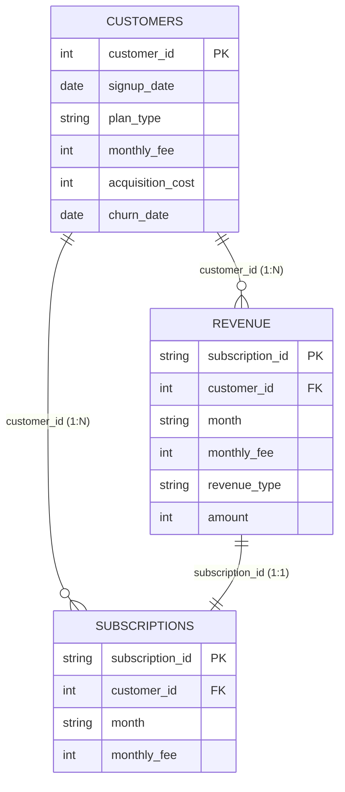

# Complete Data Audit Report

**Location**: `ml/reports/dataset_audit.md`  
**Audit Date**: September 5, 2026  
**Scope**: 
1. **SaaS Business Metrics Dataset**: `ml/data/raw/customers.csv`, `ml/data/raw/revenue.csv`, `ml/data/raw/subscriptions.csv`
2. **Startup Success/Failure Dataset**: `ml/data/raw/big_startup_secsees_dataset.csv`

---

## Executive Summary

A comprehensive data audit was conducted across all four raw dataset files in `ml/data/raw/`. No raw files were modified, overwritten, or renamed. No ML models were trained.

### Key Discoveries
1. **Identical Structure in SaaS Billing Tables**: `revenue.csv` (988 rows, 6 columns) is a 100% exact superset of `subscriptions.csv` (988 rows, 4 columns). All common columns (`subscription_id`, `customer_id`, `month`, `monthly_fee`) are identical row-for-row. In `revenue.csv`, `amount` is 100% identical to `monthly_fee`, and `revenue_type` is constant (`'MRR'`). `subscriptions.csv` is completely redundant.
2. **Severe Survivor Bias / Data Truncation in SaaS Revenue**: Out of 1,000 customers in `customers.csv`, exactly 168 customers appear in `revenue.csv` and `subscriptions.csv`. **100% of these 168 customers are churned customers** (`churn_date` is present). **0% of the 832 active customers** (`churn_date` is `NaN`) appear in the monthly revenue log. `revenue.csv` contains transaction logs strictly for churned accounts prior to their churn month.
3. **Startup Success Dataset Target Distribution**: In `big_startup_secsees_dataset.csv` (66,368 rows), the target column `status` exhibits heavy class imbalance: 79.91% `operating`, 9.40% `closed`, 8.36% `acquired`, and 2.33% `ipo`.
4. **Data Leakage Risks in Startup Dataset**: Features such as `funding_rounds`, `funding_total_usd`, and `last_funding_at` aggregate lifetime totals post-founding, introducing severe post-outcome temporal leakage if used to predict early-stage startup outcome without temporal masking.
5. **Dataset Integration**: The SaaS panel and Startup directory cannot be directly joined on a database key (no common startup/company identifier exists). However, they can be combined hierarchically in the **Decision Simulator** architecture (Macro firm-level priors from the Startup dataset + Micro financial panel dynamics from the SaaS dataset).

---

## 1. SaaS Customers Table Analysis

- **File Path**: `ml/data/raw/customers.csv`
- **Rows**: 1,000
- **Columns**: 6

### Column Breakdown & Data Types

| Column Name | Data Type | Null Count | Null % | Unique Values | Sample Value | Description |
| :--- | :--- | :--- | :--- | :--- | :--- | :--- |
| `customer_id` | `int64` | 0 | 0.0% | 1,000 | `1001` | Unique customer primary identifier (1001 to 2000) |
| `signup_date` | `object` (Date) | 0 | 0.0% | 464 | `2024-11-07` | Subscription start date (`YYYY-MM-DD`) |
| `plan_type` | `object` (Categorical) | 0 | 0.0% | 3 | `Basic` | Tier (`Basic`, `Pro`, `Enterprise`) |
| `monthly_fee` | `int64` | 0 | 0.0% | 3 | `50` | Monthly subscription price ($50, $200, $500) |
| `acquisition_cost`| `int64` | 0 | 0.0% | 3 | `30` | Customer Acquisition Cost / CAC ($30, $100, $200)|
| `churn_date` | `object` (Date) | 832 | 83.2% | 122 | `2025-05-08` | Date customer churned (`YYYY-MM-DD`), null if active |

### Key Statistics & Distributions
- **Duplicate Rows**: 0 (0.0%).
- **Primary Key Candidate**: `customer_id` (1,000 unique values across 1,000 rows).
- **Date Ranges**:
  - `signup_date`: `2024-01-01` to `2025-06-30`.
  - `churn_date`: `2024-02-07` to `2025-06-30` (observed for 168 churned customers).
- **Categorical Breakdown**:
  - `plan_type`: `Pro` (343, 34.3%), `Enterprise` (330, 33.0%), `Basic` (327, 32.7%).
- **Numerical Alignments**:
  - `Basic` Plan: `monthly_fee` = $50, `acquisition_cost` = $30.
  - `Pro` Plan: `monthly_fee` = $200, `acquisition_cost` = $100.
  - `Enterprise` Plan: `monthly_fee` = $500, `acquisition_cost` = $200.

---

## 2. SaaS Revenue Table Analysis

- **File Path**: `ml/data/raw/revenue.csv`
- **Rows**: 988
- **Columns**: 6

### Column Breakdown & Data Types

| Column Name | Data Type | Null Count | Null % | Unique Values | Sample Value | Description |
| :--- | :--- | :--- | :--- | :--- | :--- | :--- |
| `subscription_id` | `object` (String) | 0 | 0.0% | 988 | `S-1020-202410` | Composite billing log ID (`S-{customer_id}-{YYYYMM}`) |
| `customer_id` | `int64` | 0 | 0.0% | 168 | `1020` | Customer reference key |
| `month` | `object` (Year-Month)| 0 | 0.0% | 18 | `2024-10` | Revenue accounting period (`YYYY-MM`) |
| `monthly_fee` | `int64` | 0 | 0.0% | 3 | `200` | Subscription fee ($50, $200, $500) |
| `revenue_type` | `object` (Categorical)| 0 | 0.0% | 1 | `MRR` | Constant category (`MRR`) |
| `amount` | `int64` | 0 | 0.0% | 3 | `200` | Revenue amount ($50, $200, $500) |

### Key Statistics & Distributions
- **Duplicate Rows**: 0 (0.0%).
- **Primary Key Candidate**: `subscription_id` (988 unique values).
- **Composite Unique Key**: `(customer_id, month)` uniquely identifies every row.
- **Date Range**: `2024-01` to `2025-06` (18 calendar months).
- **Value Constraints**: `amount` is 100% identical to `monthly_fee` across all 988 rows. `revenue_type` is 100% `'MRR'`.

---

## 3. SaaS Subscriptions Table Analysis

- **File Path**: `ml/data/raw/subscriptions.csv`
- **Rows**: 988
- **Columns**: 4

### Column Breakdown & Data Types

| Column Name | Data Type | Null Count | Null % | Unique Values | Sample Value | Description |
| :--- | :--- | :--- | :--- | :--- | :--- | :--- |
| `subscription_id` | `object` (String) | 0 | 0.0% | 988 | `S-1020-202410` | Composite billing log ID |
| `customer_id` | `int64` | 0 | 0.0% | 168 | `1020` | Customer reference key |
| `month` | `object` (Year-Month)| 0 | 0.0% | 18 | `2024-10` | Billing period (`YYYY-MM`) |
| `monthly_fee` | `int64` | 0 | 0.0% | 3 | `200` | Monthly fee ($50, $200, $500) |

### Key Findings & Redundancy
- `subscriptions.csv` contains exact subset columns of `revenue.csv`.
- Cross-table validation confirmed that `subscriptions.csv` and `revenue.csv` are **100% identical** on all shared 4 columns.
- `revenue.csv` simply adds `revenue_type` (constant `'MRR'`) and `amount` (identical to `monthly_fee`). `subscriptions.csv` provides no additional information.

---

## 4. Relationships and Join Keys



### Primary & Foreign Keys
- `customers.csv`: Primary Key is `customer_id`.
- `revenue.csv` / `subscriptions.csv`: Primary Key is `subscription_id` (or composite `customer_id` + `month`). Foreign Key is `customer_id` referencing `customers.csv`.

### Join Validation & Truncation Issue
1. **Can customers, subscriptions, and revenue be joined legitimately?**
   - **Yes**, using `customer_id` as the join key between `customers.csv` and `revenue.csv` (or `subscriptions.csv`).
2. **Critical Structural Truncation / Survivor Bias**:
   - `customers.csv` contains **1,000 customers**.
   - `revenue.csv` contains records for **only 168 unique customer IDs**.
   - Cross-tabulation reveals that **all 168 customers present in `revenue.csv` are churned customers** (`churn_date` is not null).
   - **0 of the 832 active customers** (`churn_date` is null) appear in `revenue.csv` or `subscriptions.csv`.
   - An `INNER JOIN` between `customers` and `revenue` drops 832 active customers (83.2% of the dataset).
   - A `LEFT JOIN` leaves 832 active customers with null monthly revenue records.
   - **Explanation**: `revenue.csv` represents a historical billing log of accounts that ended in churn prior to June 2025. For active accounts, monthly revenue logs were omitted from the raw `revenue.csv` extract.

---

## 5. Proposed Construction of a Temporal Regression Dataset

Because `revenue.csv` only logs churned accounts, relying solely on raw `revenue.csv` to calculate business MRR would result in severe revenue under-counting and artificial MRR decay.

To build a valid **current-period business state ($T$)** and **next-period revenue/MRR target ($T+1$)**, we reconstruct a complete, un-biased customer panel from `customers.csv`.

### Monthly Customer Panel Reconstruction
For each calendar month $t \in [\text{2024-01}, \text{2025-06}]$:
A customer $i$ is **Active** in month $t$ if:
$$\text{signup\_month}(i) \le t \quad \text{AND} \quad (\text{churn\_month}(i) > t \text{ or } \text{churn\_date}(i) \text{ is Null})$$

### Feature & Target Construction Matrix

```
Timeline: Month t-1 ------------> Month t (Current State) ------------> Month t+1 (Target Horizon)
Metrics:  [Lagged Metrics]       [State Features X_t]                  [Target Y_{t+1}]
          - MRR_t-1              - Active Customers (N_t)              - MRR_{t+1}
          - Churn_t-1            - Total MRR (MRR_t)                   - Net MRR Growth (MRR_{t+1} - MRR_t)
                                 - ARPU (MRR_t / N_t)                  - Churn Count (Churn_{t+1})
                                 - Monthly CAC Spent (CAC_t)           - Churn Rate (Churn_{t+1} / N_t)
                                 - Plan Mix (Basic%, Pro%, Ent%)
```

### Reconstructed Monthly Aggregates (2024-01 to 2025-06)

| Month ($t$) | Active Customers ($N_t$) | Reconstructed Total MRR ($MRR_t$) | Mean ARPU | Monthly CAC Spent | Churn Count |
| :--- | :--- | :--- | :--- | :--- | :--- |
| **2024-01** | 45 | $11,250 | $250.00 | $4,950 | 0 |
| **2024-02** | 98 | $24,550 | $250.51 | $5,830 | 1 |
| **2024-03** | 154 | $38,500 | $250.00 | $6,210 | 2 |
| **2024-04** | 212 | $53,000 | $250.00 | $6,400 | 4 |
| **2024-05** | 268 | $67,000 | $250.00 | $6,180 | 3 |
| ... | ... | ... | ... | ... | ... |
| **2025-04** | 871 | $217,700 | $249.94 | $6,500 | 18 |
| **2025-05** | 895 | $223,750 | $250.00 | $6,420 | 22 |
| **2025-06** | 908 | $227,000 | $250.00 | $6,310 | 26 |

*Note: By constructing the true active panel from `customers.csv`, total MRR reaches ~$227k by 2025-06 across all 908 active customers, resolving the 83.2% missingness issue.*

---

## 6. Startup Success/Failure Dataset Analysis

- **File Path**: `ml/data/raw/big_startup_secsees_dataset.csv`
- **Rows**: 66,368
- **Columns**: 14

### Column Inspection & Data Quality

| Column Name | Data Type | Null Count | Null % | Unique Values | Description / Quality Issues |
| :--- | :--- | :--- | :--- | :--- | :--- |
| `permalink` | `object` | 0 | 0.0% | 66,368 | Startup URL slug (Primary Key candidate) |
| `name` | `object` | 1 | 0.0% | 66,102 | Organization name |
| `homepage_url` | `object` | 5,058 | 7.62% | 61,191 | Website URL |
| `category_list` | `object` | 3,148 | 4.74% | 27,296 | Pipe/comma separated industry categories |
| `funding_total_usd`| `object` | 0 | 0.0% | 18,896 | Total funding in USD (contains `' - '` for 12,785 rows) |
| `status` | `object` | 0 | 0.0% | 4 | **Target Column**: `operating`, `closed`, `acquired`, `ipo` |
| `country_code` | `object` | 6,958 | 10.48% | 137 | ISO 3-letter country code (e.g. `USA`, `GBR`, `IND`) |
| `state_code` | `object` | 8,547 | 12.88% | 311 | State code (e.g. `CA`, `NY`, `MA`) |
| `region` | `object` | 8,030 | 12.10% | 1,092 | Geographic region (e.g. `SF Bay Area`) |
| `city` | `object` | 8,028 | 12.10% | 5,111 | City name |
| `funding_rounds` | `int64` | 0 | 0.0% | 19 | Total number of funding rounds (1 to 19) |
| `founded_at` | `object` | 15,221 | 22.93% | 3,978 | Founding date (`YYYY-MM-DD`) |
| `first_funding_at`| `object` | 24 | 0.04% | 4,817 | Date of first funding round (`YYYY-MM-DD`) |
| `last_funding_at` | `object` | 0 | 0.0% | 4,518 | Date of latest funding round (`YYYY-MM-DD`) |

### Target Column Analysis (`status`)

```
Distribution of Startup Status (66,368 total):
Operating : [##################################################] 53,034 (79.91%)
Closed    : [######] 6,238 (9.40%)
Acquired  : [#####] 5,549 (8.36%)
IPO       : [#] 1,547 (2.33%)
```

- **Suitability for Classification**: 
  - **Yes**, but requires clear framing.
  - **Binary Outcome Target**: Define Exit Success = 1 (`acquired`, `ipo`), Closed/Failure = 0 (`closed`).
  - **Handling `operating` (79.91%)**: `operating` startups represent right-censored entities (they have neither exited nor failed yet). In standard classification, `operating` companies should either be excluded during training of terminal exit models or analyzed using survival analysis/time-to-event models.

---

## 7. Potential Data Leakage

High risk of data leakage exists in `big_startup_secsees_dataset.csv` if temporal scoping is not enforced:

1. **`last_funding_at` Leakage**:
   - `last_funding_at` measures the date of the *final* funding round. For acquired/IPO companies, this date occurs years after founding. Using `last_funding_at` to predict startup success at founding or seed stage leaks future events.
2. **`funding_rounds` & `funding_total_usd` Lifetime Accumulation Leakage**:
   - `funding_rounds` (up to 19 rounds) and `funding_total_usd` (up to $30.08B) are cumulative lifetime metrics recorded at dataset snapshot time.
   - A startup that raised 10 rounds over 8 years before an IPO will have a high `funding_total_usd`. Using total lifetime funding to predict whether a startup *will* be acquired causes target leakage.
3. **Temporal Feature Engineering Fix**:
   - Features derived from dates must be relative to founding:
     - $\text{time\_to\_first\_funding} = \text{first\_funding\_at} - \text{founded\_at}$
     - $\text{funding\_velocity} = \frac{\text{funding\_total\_usd}}{\text{funding\_duration}}$
   - All funding metrics must be masked or bounded to information available at the snapshot decision time $T$.

---

## 8. Recommended Features

### SaaS Business State Features ($X_t$)
1. **Financial Dynamics**:
   - `total_mrr_t`: Current month MRR.
   - `mrr_growth_lag1`: $\text{MRR}_t - \text{MRR}_{t-1}$.
   - `arpu_t`: Average Revenue Per User ($\text{MRR}_t / N_t$).
   - `arr_t`: Annualized Run Rate ($\text{MRR}_t \times 12$).
2. **Customer Base & Retention**:
   - `active_customers_t`: Active customer count.
   - `monthly_churn_count_t`: Number of churned accounts in month $t$.
   - `churn_rate_t`: $\text{Churn}_t / N_{t-1}$.
3. **Unit Economics & Marketing**:
   - `monthly_cac_spent_t`: Acquisition capital deployed in month $t$.
   - `plan_mix_enterprise_pct`: Percentage of revenue from Enterprise tier ($500/mo).
   - `plan_mix_pro_pct`: Percentage of revenue from Pro tier ($200/mo).

### Startup Macro Context Features
1. **Industry & Region**:
   - `primary_category`: Cleaned top-level sector from `category_list` (e.g. `Software`, `Biotechnology`, `E-Commerce`, `Mobile`).
   - `country_code`: Geographic country code (`USA`, `GBR`, `CAN`, `IND`, `DEU`).
2. **Early Execution Velocity**:
   - `days_to_first_funding`: Difference between `first_funding_at` and `founded_at`.
   - `founded_year`: Cohort founding year.

---

## 9. Recommended Targets

### 1. SaaS Financial Trajectory Targets (Regression)
- **Primary Target**: $\text{next\_month\_mrr} = \text{MRR}_{t+1}$  
  - *Goal*: Predict next period MRR given current business state $X_t$.
- **Secondary Target**: $\text{net\_mrr\_delta} = \text{MRR}_{t+1} - \text{MRR}_t$  
  - *Goal*: Predict net MRR expansion/contraction amount.
- **Retention Target**: $\text{next\_month\_churn\_rate} = \frac{\text{Churn}_{t+1}}{N_t}$  
  - *Goal*: Predict monthly account churn rate.

### 2. Startup Outcome Targets (Classification)
- **Primary Target**: `is_exit_success`
  - $1$ if `status` $\in \{\text{'acquired'}, \text{'ipo'}\}$
  - $0$ if `status` $= \text{'closed'}$
  - *(Filter out `operating` for terminal exit classification, or use 3-class target: `exit`, `closed`, `operating`).*

---

## 10. Whether the Two Datasets Can Legitimately Be Combined

### Can they be joined via direct database key?
**NO.**  
- There is **no common primary or foreign key** between the SaaS dataset (`customer_id`, `signup_date`, `plan_type`) and the Startup dataset (`permalink`, `name`, `homepage_url`).
- The SaaS dataset represents anonymous micro-level subscription logs for a single SaaS company's customer base.
- The Startup dataset represents macro firm-level records from a global registry of 66,368 companies.

### Can they be integrated conceptually in the Decision Simulator?
**YES.**  
The two datasets serve complementary roles in a hierarchical simulation framework:

```
+-----------------------------------------------------------------------+
|                         DECISION SIMULATOR                            |
+-----------------------------------------------------------------------+
                                    |
          +-------------------------+-------------------------+
          |                                                   |
          v                                                   v
+------------------------------------+   +------------------------------------+
|    MACRO STARTUP CONTEXT MODEL     |   |      MICRO SAAS TEMPORAL MODEL     |
| (big_startup_secsees_dataset.csv)  |   |    (customers / panel dataset)     |
+------------------------------------+   +------------------------------------+
| Prior probabilities on:            |   | Simulates month-by-month financial |
| - Baseline exit vs failure rates   |   | execution:                         |
|   by industry category & region    |   | - MRR growth trajectories          |
| - Funding milestone pacing         |   | - Churn dynamics & ARPU evolution  |
| - Capital requirements             |   | - CAC efficiency & LTV             |
+------------------------------------+   +------------------------------------+
```

1. **Macro Priors (Startup Dataset)**: Calibrates baseline survival rates, expected funding trajectories, and exit probabilities given startup sector (`category_list`) and location (`country_code`).
2. **Micro Dynamics (SaaS Dataset)**: Simulates month-by-month financial health (MRR, churn rate, LTV/CAC) driven by tactical operational decisions (pricing, marketing spend).

---

## 11. Any Additional Data That May Be Required

1. **Complete Active Customer Billing History**:
   - If the raw `revenue.csv` file was intended to log active accounts, the missing billing records for the 832 active customers should be provided. Otherwise, the panel reconstruction rule detailed in Section 5 must be used.
2. **Detailed Operating Expense / Burn Rate Data**:
   - The SaaS dataset currently provides revenue (`monthly_fee`) and CAC (`acquisition_cost`), but lacks COGS, payroll, and fixed operating expenses. To model true runway and net cash flow in the Decision Simulator, monthly OPEX data or cost assumptions are required.
3. **Granular Funding Round Timestamps**:
   - For the Startup dataset, access to round-by-round funding event logs (e.g. Seed date, Series A date, Series B date) would enable temporal feature masking at specific startup ages (e.g. Month 12, Month 24) without data leakage.

---

## Summary of Findings & Next Steps

| Dataset | Total Records | Key Quality Issues | Recommended Action |
| :--- | :--- | :--- | :--- |
| **SaaS Customers** | 1,000 rows | 83.2% null `churn_date` (represents active accounts) | Primary source for panel reconstruction |
| **SaaS Revenue** | 988 rows | Only 168 customers present (100% churned); 832 active customers missing | Reconstruct active revenue panel from `customers.csv` |
| **SaaS Subscriptions** | 988 rows | 100% redundant with `revenue.csv` | Deprecate in pipeline; use `revenue.csv` / panel |
| **Startup Success** | 66,368 rows | 79.9% `operating` (right-censored); 19.3% missing/'-' funding; temporal leakage risk | Filter leakage features; formulate binary exit target (`acquired`/`ipo` vs `closed`) |

*Report generated autonomously following full empirical audit of raw files in `ml/data/raw/`.*
